# Этап 1. Архитектурное исследование приложения «Городские услуги»

Дата исследования: 28.10.2026.

Исходный репозиторий: <https://github.com/jacksever/city-services/>. Исследовано состояние приложения на коммите `d50136a` (код приложения соответствует исходному `6412dc2`; последующий коммит добавил документацию).

## 1. Цель и границы исследования

Цель этапа: установить фактическое устройство работающего проекта, выявить зависимости и точки распространения изменений, проверить наличие циклов и определить проблемы, которые следует учитывать при последующем проектировании.

Анализ охватывает production Kotlin-код, Android Manifest, Gradle-конфигурацию и существующие unit-тесты. Исходники приложения не изменялись. ADR, целевая архитектура и реорганизация кода относятся к следующим этапам и здесь не подменяют описание исходного состояния.

### 1.1. Соответствие заданию

| Требование первого этапа | Результат |
|---|---|
| Компоненты системы | Разделы 3 и 8, рисунки 1 и 8 |
| Зависимости и их направления | Разделы 4 и 5, рисунки 2-5 и 10 |
| Наиболее связанные компоненты | Раздел 6, рисунок 6, полные метрики в `analysis.json` |
| Циклические зависимости | Раздел 5.3, автоматическая проверка SCC и циклов |
| Распространение моделей данных | Раздел 7, рисунок 7 |
| Зависимость UI от инфраструктуры | Раздел 8, рисунок 8 |
| Большой радиус изменений | Разделы 6 и 11 |
| Граф импортов | `images/01-imports.png` |
| Граф модулей | `images/04-gradle-modules.png`; отдельно граф пакетов `03-packages.png` |
| Иные архитектурные проверки | Разделы 9, 10 и 12, матрица `09-dependency-matrix.png` |

### 1.2. Методика и ограничения

1. Инвентаризация файлов, пакетов и Gradle-модулей.
2. Извлечение объявлений и внутренних импортов из Kotlin.
3. Дополнение импортов ссылками на top-level объявления своего пакета, для которых Kotlin не требует import.
4. Построение направленных графов файлов и пакетов, вычисление fan-in, fan-out, транзитивных потребителей, компонент сильной связности (SCC).
5. Ручное чтение сценариев, владельцев состояния, синхронизации, моделей и тестов.
6. Попытка запуска исходных unit-тестов и отдельная проверка артефактов исследования.

Скрипт `analyze.py` выполняет **лексический, а не компиляторный анализ**. Он не разрешает перегрузки, рефлексию, динамический dispatch, generated Room/KSP-код и зависимости Android framework. Ссылки своего пакета определяются по именам; их небольшой набор проверен по исходникам. Импорт сам по себе не всегда означает исполняемый вызов. Семантические выводы ниже подтверждены чтением соответствующих мест, а не только формой графа.

Единица графа файлов: `.kt`-файл, а не отдельный класс. Например, `DomainModels` содержит три объявления, `RequestsScreen` содержит экран и ViewModel. Внутрифайловые связи исключены. Графы зависимостей не являются диаграммами движения данных; поток данных показан отдельно.

Во всех ссылках далее `src` означает `app/src/main/kotlin/ru/course/cityservices`, `test` означает `app/src/test/kotlin/ru/course/cityservices`. Номера строк относятся к исследованному исходному состоянию.

## 2. Характеристика проекта

**Контекст курсовой:** приложение предназначено для РУТ (МИИТ), Российского университета транспорта. Пользовательские истории рассматриваются от лица пользователя университета. Далее исследуется фактический исходный код учебного проекта: названия «Городские услуги», «Личный кабинет жителя» и городские примеры в нём пока сохранены. Это наследованные тексты, а не указание на муниципальную целевую аудиторию. Разделение университетских ролей и доставка обращений реальным службам в исходной реализации отсутствуют.

Приложение реализует вход, каталог услуг, карточку услуги, создание обращения, историю заявок и внутриприложные уведомления. Сервер имитируется `FakeApi`; реального HTTP-клиента, backend-проекта и push-уведомлений в составе репозитория нет. Уведомления создаются внутри приложения при сравнении локального и серверного статусов.

| Характеристика | Значение |
|---|---|
| Gradle-модули приложения | 1: `:app` |
| Основные Kotlin-файлы | 23 |
| Строки основных Kotlin-файлов | 1750, включая комментарии и пустые строки |
| Логические пакеты, включая корневой | 12 |
| Unit-test файлы | 4 |
| Instrumented / Compose UI tests | В исходном проекте не обнаружены |
| Внутренние связи явных импортов | 38 уникальных пар файлов |
| Дополнительные связи своего пакета | 4 уникальные пары файлов |
| Все обнаруженные связи файлов | 42 |
| Межпакетные связи | 21 уникальная направленная пара |
| Нетривиальные SCC файлов / пакетов | 0 / 0 |

Стек: Kotlin, Jetpack Compose, Lifecycle ViewModel, Coroutines, Room, DataStore Preferences. Физическое хранение разделено: заявки в Room, сессия в DataStore, каталог и уведомления преимущественно в памяти.

Конфигурация: `minSdk=31`, `targetSdk=compileSdk=37`, JVM/toolchain 21 (`app/build.gradle.kts:7-33`); Gradle 9.7.1 (`gradle/wrapper/gradle-wrapper.properties:3`); AGP 9.4.0, Kotlin Compose plugin 2.4.10, KSP 2.3.11 (`build.gradle.kts:1-5`). Библиотеки представлены на рисунке 5, их версии указаны в Gradle-конфигурации. Наличие зависимости `lifecycle-viewmodel-compose` не доказывает последовательное использование MVVM.

## 3. Компоненты и ответственность

Пользовательская сторона исследования вынесена в отдельное приложение к этапу: [Пользовательские истории и пошаговые сценарии](../user-stories/Пользовательские%20истории.md). В нём описаны 9 историй и 30 шагов; каждый шаг сопровождается реальным экраном установленного приложения с пометками действий. Происхождение снимков, ограничения проверки APK и наблюдаемые особенности исходного UI указаны в самом документе. Эти иллюстрации имеют отдельные обозначения US-01–US-09 и не меняют нумерацию архитектурных рисунков.

| Компонент | Файлы | Фактическая ответственность |
|---|---|---|
| Точка входа | `MainActivity.kt` | Инициализация инфраструктуры, подключение темы и Compose |
| Корневая композиция | `CityServicesApp.kt` | Строковые маршруты, восстановление сессии, polling, переходы между экранами |
| UI экранов | `ui/screen/*` | Вход, каталог, форма обращения, история, уведомления; часть операций выполняется прямо из UI |
| UI-компоненты | `ui/component/*`, `ui/theme/Theme.kt` | Карточка услуги, оформление статуса, тема |
| Центральный orchestration | `core/ServiceLocator.kt` | Создание API/Room/DataStore, вход/выход, каталог, отправка и синхронизация заявок, аналитика, уведомления, запись UI-state |
| Глобальное состояние | `state/AppState.kt` | Признак входа, пользователь, каталог, выбранная услуга, общая ошибка, уведомления |
| API-контракт | `network/CityApi.kt` | Suspend-методы и `AuthResponse` |
| Имитация сервера | `network/FakeApi.kt` | Демоаккаунт, каталог, заявки в памяти, задержки, смена статусов и воспроизводимый timeout |
| Локальное хранение заявок | `storage/AppDatabase.kt`, `RequestDao.kt`, `InstantConverter.kt` | Room database, CRUD/выборки, преобразование Instant |
| Хранение сессии | `storage/SessionStore.kt` | DataStore Preferences и `SessionData` |
| Общие модели | `model/Models.kt` | Сетевые ответы, Room Entity и уведомление |
| Домен | `domain/DomainModels.kt`, `RequestValidator.kt` | Типизированные статусы, альтернативная модель заявки, правила переходов и валидация |
| Аналитика | `analytic/AnalyticsTracker.kt` | In-memory события и Android Log |
| Форматирование | `util/TimeFormat.kt` | Относительное представление времени |

**Классификация архитектуры:** монолитный Android-модуль с пакетным разделением по техническим ролям, глобальным состоянием и централизованным процедурным orchestration. ViewModel применяются частично. Репозиториев и последовательно выделенного application/domain слоя между UI и инфраструктурой нет. Это не означает, что небольшому приложению обязательно нужны дополнительные Gradle-модули; проблема заключается прежде всего в смешении ответственности и слабых инвариантах состояния.

## 4. Графы исходной структуры

### Рисунок 1. Общая схема текущей архитектуры

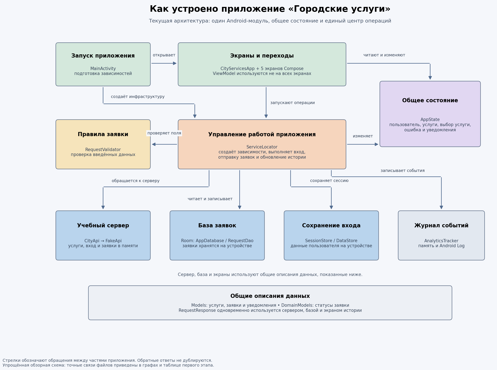

Это единая обзорная схема исходного приложения, а не проект его будущей реорганизации. В верхней части показаны запуск и пользовательские экраны, в центре — управление операциями и общее состояние, ниже — учебный сервер и средства хранения. Внизу отдельно отмечены общие описания данных, которые используются сразу в нескольких частях приложения.

Стрелки означают обращения: экран запускает операцию, `ServiceLocator` обращается к серверу и хранилищам, а также изменяет `AppState`. Экраны читают общее состояние и в отдельных случаях сами меняют его. Ответы на вызовы не изображены отдельными обратными стрелками, чтобы не перегружать схему. Наличие горизонтальных уровней здесь помогает чтению, но не означает, что исходный код уже разделён на независимые архитектурные слои.

Важная особенность: `ServiceLocator` одновременно создаёт зависимости и выполняет пользовательские сценарии. История заявок читается через него из Room, а не напрямую из `AppState`; в `AppState` находятся каталог, пользователь и уведомления. Учебный сервер работает в памяти приложения, реального удалённого сервера на схеме нет. Подробные связи отдельных файлов и вспомогательных UI-компонентов раскрыты на последующих рисунках.

### Рисунок 2. Какие части кода используют друг друга

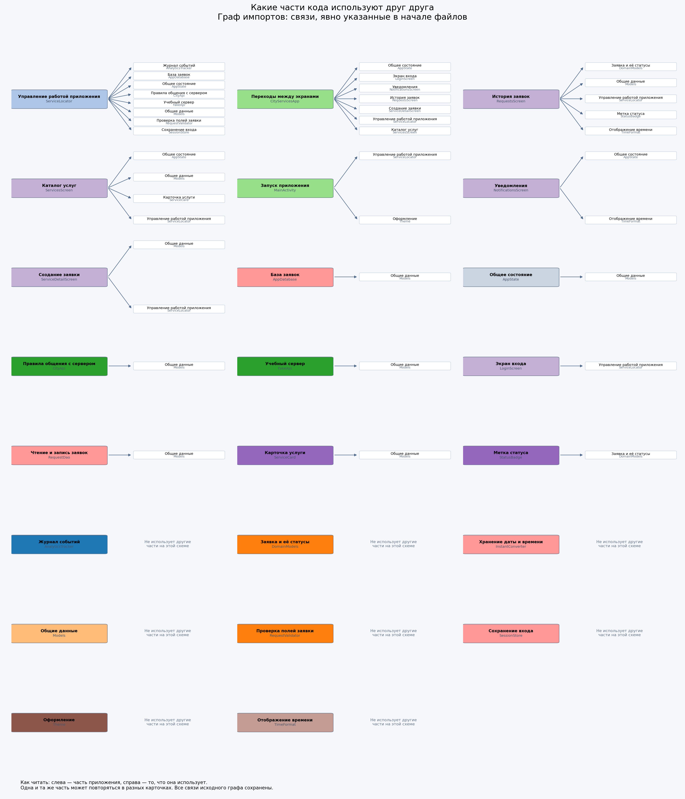

Стрелка `A → B` означает, что файл A явно импортирует объявление B. Все 23 файла включены, даже если у файла нет внутренних import. Android/Compose и стандартная библиотека не разворачиваются в сотни отдельных узлов, чтобы сохранить читаемость. Их прямые зависимости перечислены в `analysis.json` в поле `files.*.imports`.

### Рисунок 3. Полная картина связей между файлами

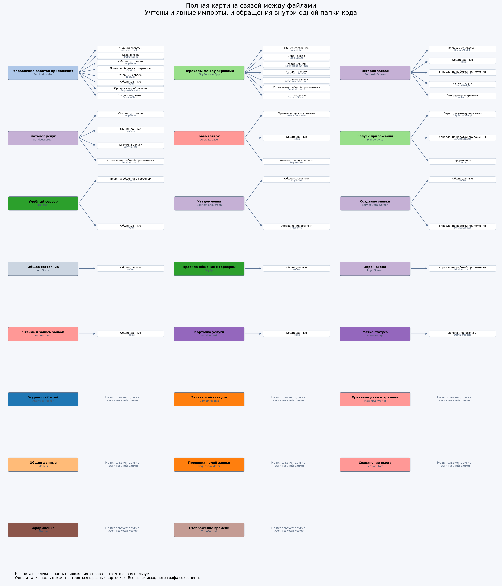

Добавлены четыре пары, отсутствующие в явных import: `MainActivity → CityServicesApp`, `FakeApi → CityApi`, `AppDatabase → RequestDao`, `AppDatabase → InstantConverter`. У пары `FakeApi → CityApi` два основания: интерфейс `CityApi` и `AuthResponse`, которые объявлены в одном файле.

### Рисунок 4. Как связаны основные части приложения

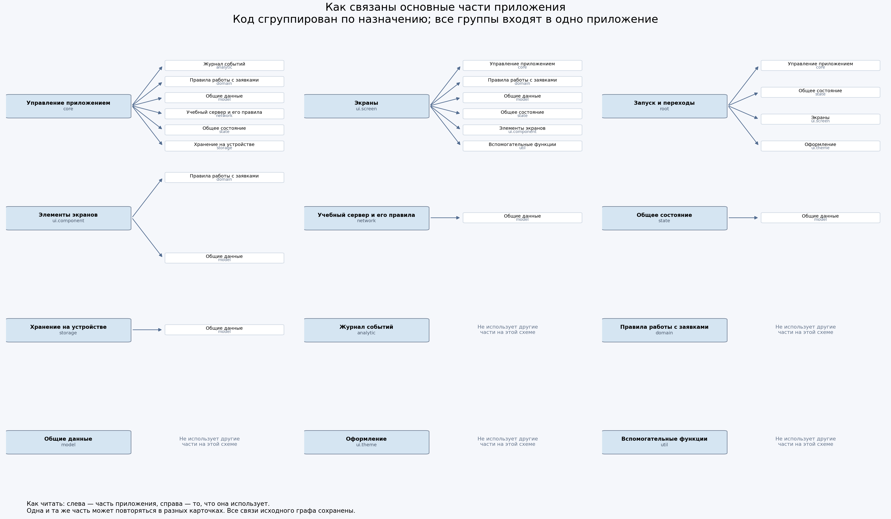

`root` на схеме означает пакет `ru.course.cityservices`, а не Gradle root project. Каждый узел является группой файлов внутри одного Android-модуля. Пакетные границы не ограничивают доступ компилятором так, как отдельные модули с закрытыми реализациями.

### Рисунок 5. Из чего собирается приложение

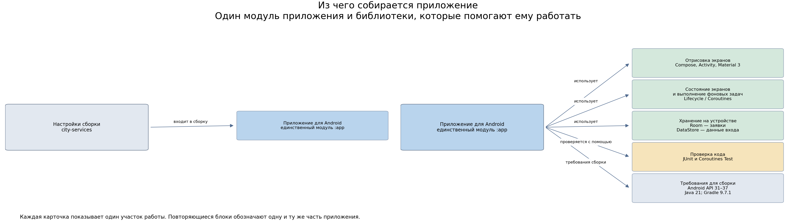

`settings.gradle.kts:19` включает только `:app`. Стрелка от root к `:app` означает включение в сборку, **не** `implementation(project(...))`. Внутренних межмодульных implementation-зависимостей нет. Внешние библиотеки имеют одинаковую доступность в production source set независимо от логического пакета: технически UI может импортировать Room напрямую, хотя фактические экраны этого не делают.

## 5. Направления и цикличность

### 5.1. Основные направления

Основная цепочка статических зависимостей:

`MainActivity / CityServicesApp / экраны → ServiceLocator → CityApi, FakeApi, Room, SessionStore, AnalyticsTracker, RequestValidator`.

Параллельные зависимости:

- `UI → AppState → общие модели`.
- `ServiceLocator → AppState`: orchestration напрямую управляет состоянием представления.
- `UI → model`, `network → model`, `storage → model`: единые модели пересекают границы сети, диска и UI.
- `StatusBadge / RequestsScreen → domain`: доменные статусы используются частично.
- `domain` не импортирует инфраструктуру: это полезная исходная граница, но большая часть сценариев выполняется за её пределами.

### 5.2. Почему ацикличность не равна качественной архитектуре

Файл `Models.kt` не импортирует другие файлы проекта, но зависит от аннотаций Room. Поэтому нулевой внутренний fan-out не означает независимость от инфраструктуры. Аналогично отсутствие циклов не устраняет зависимость всех сценариев от глобального объекта.

### 5.3. Проверка циклов

Для направленного графа используются strongly connected components и перечисление простых циклов. Нетривиальная SCC содержит больше одного узла; внутри неё каждый узел достижим из любого другого.

| Граф | Проверка | Результат |
|---|---|---|
| Явные import | Ацикличность, следует также из расширенного графа | Циклы не обнаружены |
| Файлы: imports + same-package | SCC и `simple_cycles` | `file_scc=[]`, `file_cycles=[]` |
| Пакеты | SCC | `package_scc=[]` |
| Внутренние Gradle-модули | Единственный `:app` | Межмодульный цикл невозможен в текущей структуре |

В графах красным выделялись бы рёбра внутри нетривиальных SCC; таких рёбер нет. Отдельная вымышленная «схема найденного цикла» не создавалась. Результат относится к обнаруженным статическим зависимостям, не к динамическим цепочкам callback и обновления состояния.

## 6. Связанность и радиус изменений

`fan-in` = число файлов, непосредственно зависящих от файла; `fan-out` = число внутренних файлов-зависимостей. Транзитивные потребители = все узлы, из которых существует путь до файла. Это **верхняя структурная оценка потенциального влияния**, а не число файлов, которые обязательно придётся редактировать.

| Файл | Строк | Fan-in | Fan-out | Транзитивных потребителей |
|---|---:|---:|---:|---:|
| `Models` | 31 | 10 | 0 | 14 |
| `ServiceLocator` | 206 | 6 | 8 | 6 |
| `AppState` | 51 | 4 | 1 | 8 |
| `CityApi` | 30 | 2 | 1 | 8 |
| `DomainModels` | 54 | 2 | 0 | 4 |
| `TimeFormat` | 27 | 2 | 0 | 4 |
| `RequestDao` | 26 | 1 | 1 | 8 |
| `AppDatabase` | 16 | 1 | 3 | 7 |
| `FakeApi` | 252 | 1 | 2 | 7 |
| `CityServicesApp` | 104 | 1 | 7 | 1 |
| `RequestsScreen` | 201 | 1 | 5 | 2 |

Полная таблица для 23 файлов находится в `analysis.json`, поле `metrics`.

### Рисунок 6. Какие части влияют на большее число файлов

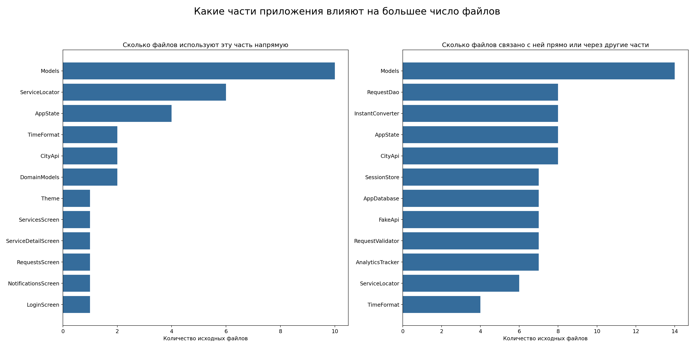

`Models` является наиболее распространённым контрактом. `ServiceLocator` имеет максимальный fan-out и смешивает много причин изменения. `AppState` распространяет изменения через глобальное состояние. `CityServicesApp` имеет большой fan-out из-за естественной роли композиции экранов; сам по себе этот показатель не делает его дефектом.

Ограничение файловой агрегации: зависимость `StatusBadge → DomainModels` вызвана `RequestStatus`, но не означает, что UI использует `ServiceRequest` или `StatusRules`. Поэтому выводы об использовании отдельных моделей ниже сделаны вручную.

## 7. Распространение моделей данных

### Рисунок 7. Где используются общие данные приложения

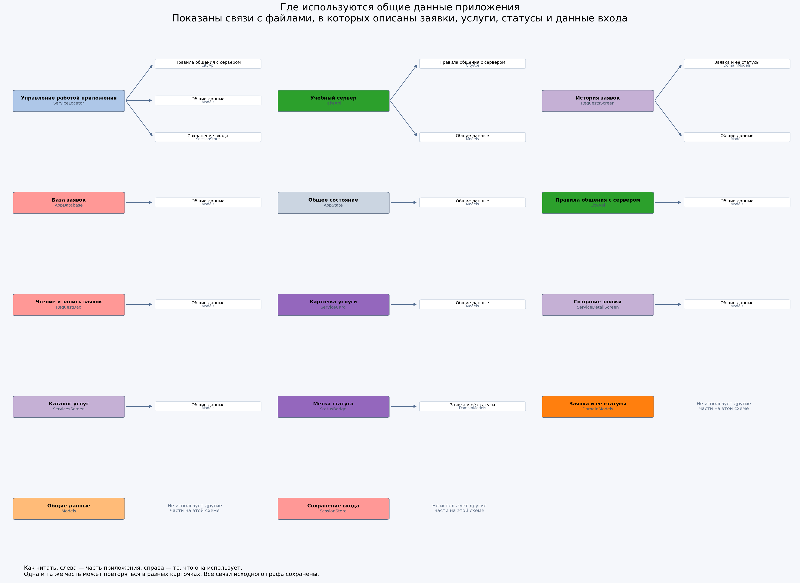

На этой схеме стрелки показывают, какие файлы используют описания общих данных, **а не направление передачи данных во время работы**. Каждая карточка читается слева направо. Повторяющиеся названия обозначают один и тот же файл; такое разделение убирает пересечения несвязанных линий. `CityApi` также сам зависит от общих моделей.

Ограничение рисунка: это файловая проекция, а не точный граф ссылок на типы данных. Файлы `CityApi` и `SessionStore` содержат и модели, и инфраструктурные объявления. Поэтому, например, `ServiceLocator → SessionStore` включает использование самого хранилища, а `FakeApi → CityApi` также реализацию интерфейса. Эти рёбра нельзя считать отдельными доказательствами использования `SessionData` или `AuthResponse`. Фактическое прохождение конкретных моделей установлено ручным чтением и приведено в таблице ниже.

| Модель | Источник и использование | Архитектурное последствие |
|---|---|---|
| `ServiceResponse` | `model/Models.kt:7-12`; API → FakeApi / ServiceLocator → AppState → каталог, ServiceCard, форма | Сетевая модель одновременно является моделью экрана и параметром навигации |
| `RequestResponse` | `model/Models.kt:14-23`; API, FakeApi, ServiceLocator, RequestDao/AppDatabase, RequestsScreen | Один класс одновременно DTO, Room Entity и UI-модель |
| `NotificationItem` | `model/Models.kt:25-30`; ServiceLocator → AppState → NotificationsScreen | Данные уведомления и изменяемое UI-состояние совмещены; обычный `var isRead` не наблюдается Compose |
| `AuthResponse` | `network/CityApi.kt:25-29`; FakeApi → ServiceLocator | Ответ входа привязан к сетевому пакету; токена в demo-контракте нет |
| `SessionData` | `storage/SessionStore.kt:13`; DataStore → ServiceLocator → AppState | Дисковая модель обрабатывается центральным orchestration |
| `RequestStatus` | `domain/DomainModels.kt:3-30`; RequestsScreen, StatusBadge | Типизированные значения используются в UI, но persisted/network status остаётся строкой |
| `ServiceRequest` | `domain/DomainModels.kt:36-43` | Объявлена, но в рабочем production-потоке не используется |
| `StatusRules` | `domain/DomainModels.kt:48-53` | Правила переходов объявлены, но FakeApi реализует собственную строковую цепочку |

### 7.1. Совмещение DTO, Entity и UI-модели

У `RequestResponse` есть `@Entity` и `@PrimaryKey`, но этот же тип возвращает `CityApi` (`network/CityApi.kt:15-22`) и отображает карточка истории (`ui/screen/RequestsScreen.kt:143-167`). Схема локального хранения становится частью сетевого и UI-контракта.

Для маленького прототипа это сокращает код преобразований. Цена решения проявится при расхождении схем: nullable поле сервера, локальный флаг синхронизации или новое представление статуса потребуют согласования сразу нескольких подсистем. Разделение моделей следует обосновывать конкретными изменениями, а не вводить механически.

### 7.2. Статус одновременно протокол и отображаемый текст

`RequestResponse.status` хранит русскую строку (`Models.kt:19`). Цепочка переходов задана в `RequestStatus.next()` (`DomainModels.kt:16-20`) и отдельно в `FakeApi` (`network/FakeApi.kt:230-237`). Фильтрация и оформление зависят от этих названий (`RequestsScreen.kt:103-105`, `ui/component/StatusBadge.kt:21-29`).

Следствие: локализация или переименование статуса затрагивает бизнес-правило, протокол, диск и UI. Неизвестная строка не приводит автоматически к crash: badge имеет fallback. Это полезная защита отображения, но не полноценный контроль контракта.

## 8. UI и инфраструктура

### Рисунок 8. Кто за что отвечает в приложении

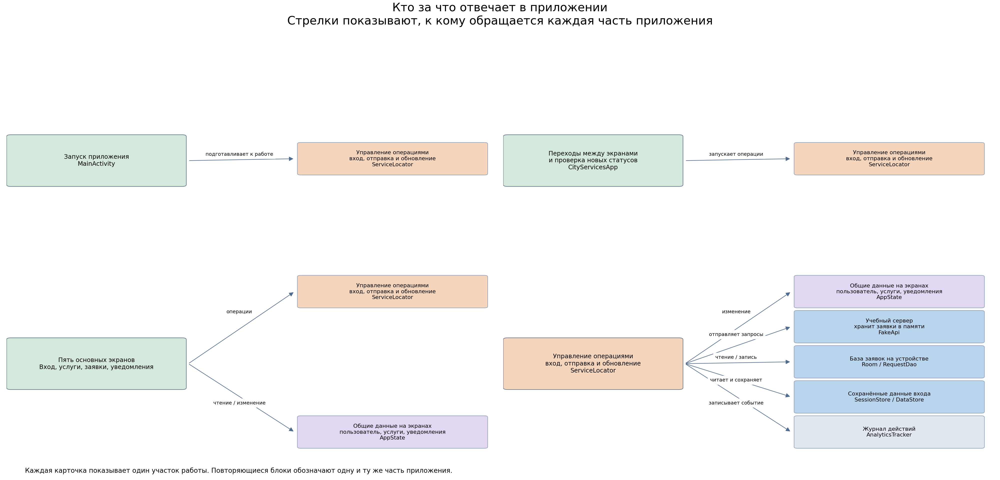

`ServiceLocator` не просто выдаёт зависимости: он выполняет сценарии, обращается к хранилищам и изменяет `AppState` (`core/ServiceLocator.kt:19-36,39-196`). UI зависит от этого конкретного singleton, а не от небольшого контракта сценария.

| UI-участок | Связь | Доказательство |
|---|---|---|
| `MainActivity` | Создаёт инфраструктуру через `init` | `MainActivity.kt:16` |
| `CityServicesApp` | Восстановление сессии, logout, периодический refresh | `CityServicesApp.kt:34-48,65-70` |
| `LoginViewModel` | Обёртка над singleton; callback возвращается в композицию | `ui/screen/LoginScreen.kt:34-50,99-102` |
| `ServicesScreen` | Читает глобальный state; ViewModel объявлена, но экран её не использует | `ui/screen/ServicesScreen.kt:36-65` |
| `ServiceDetailScreen` | Непосредственно вызывает submit из coroutine UI | `ui/screen/ServiceDetailScreen.kt:95-110` |
| `RequestsViewModel` | Читает разовые snapshots БД через singleton | `ui/screen/RequestsScreen.kt:43-64` |
| `NotificationsScreen` | Сам меняет поле элемента глобального списка | `ui/screen/NotificationsScreen.kt:66` |

Прямых вызовов Room DAO из composable нет. Инфраструктурная связанность в основном **транзитивная**, через конкретный глобальный orchestration и общие модели, а не через `import Room` во всех экранах. Заявлять обратное по этим исходникам было бы неточно.

У состояния несколько владельцев: `AppState`, локальные `remember`, ViewModel и Room. Нет общего способа восстановить черновик, доставить результат операции и наблюдать изменения БД. Это ключевая причина нескольких дефектов ниже.

## 9. Исследование сценариев и согласованности данных

### 9.1. Запуск и вход

`MainActivity.onCreate` вызывает `init`, затем Compose восстанавливает `SessionData` и переводит `AppState` в состояние входа (`MainActivity.kt:12-20`, `CityServicesApp.kt:30-37`, `ServiceLocator.kt:39-48`). Это восстановление локальных полей, не проверка серверного токена. Для offline demo допустимо, но не готовая модель безопасной авторизации.

Вход сначала меняет `AppState`, затем сохраняет сессию (`ServiceLocator.kt:55-67`). Ошибка DataStore может оставить неоднозначное состояние: пользователь уже установлен, но операция вернула ошибку. При ошибке восстановления сессии отсутствует отдельное состояние восстановления/повтора (`ServiceLocator.kt:39-40`, `CityServicesApp.kt:34-37`).

### 9.2. Создание и синхронизация заявки

### Рисунок 9. Что происходит с заявкой после отправки

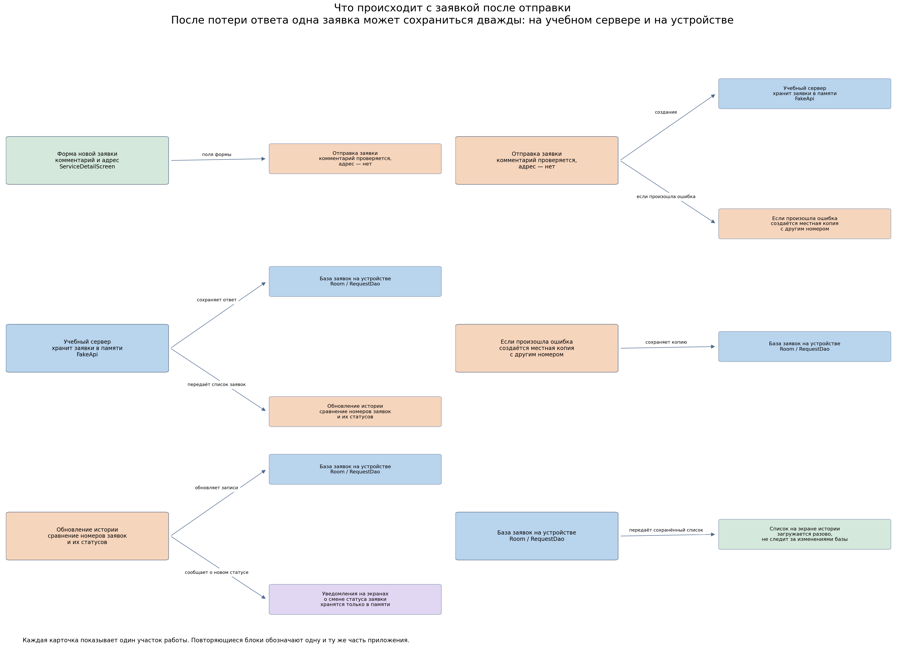

Нормальная цепочка: форма → проверка комментария → `FakeApi.createRequest` → `RequestDao.insert` → последующее чтение истории. При исключении используется fallback с другим идентификатором.

**Подтверждённая логическая проблема timeout-after-commit:** если во время `createRequest` общий счётчик API-вызовов кратен пяти, FakeApi сохраняет серверную запись, затем выбрасывает IOException (`FakeApi.kt:198-212`). Счётчик общий для login, каталога, истории и submit, поэтому это не обязательно каждая пятая отправка заявки. В обработчике клиент создаёт локальную запись с `System.currentTimeMillis()` (`ServiceLocator.kt:135-152`). Refresh сопоставляет только по ID (`ServiceLocator.kt:160-170`). Один логический submit превращается в две записи с разными идентичностями. Повторная отправка из формы создаёт ещё одну операцию, а не повторяет прежнюю с idempotency key.

Локальный fallback не является очередью offline-first: нет `pending/synced/failed`, correlation ID, outbox и повторной загрузки локальных операций на сервер (`Models.kt:15-23`, `ServiceLocator.kt:156-194`). Если запрос действительно не достигнет сервера, локальная запись самостоятельно не будет отправлена. В текущем fake timeout возникает после записи, поэтому непосредственно воспроизводимый эффект именно дубль.

### 9.3. История и уведомления

`RequestsViewModel.load()` читает список, вызывает sync, затем читает список ещё раз (`RequestsScreen.kt:51-64`). Корневая композиция независимо запускает polling каждые 30 секунд (`CityServicesApp.kt:42-48`). DAO возвращает `List`, а не `Flow` (`storage/RequestDao.kt:17-22`). Поэтому polling обновляет БД и уведомления, но открытый экран истории не получает новое состояние автоматически.

Сравнение/вставка/создание уведомлений не координируются с параллельным refresh (`ServiceLocator.kt:160-186`). Это риск гонки: два запуска могут сравнить один старый snapshot и породить одинаковые уведомления. Здесь не утверждается воспроизведение гонки на каждом запуске.

## 10. Реестр архитектурных проблем и проверок

Приоритет P1 означает угрозу согласованности или сохранности данных; P2 означает значимый функциональный/архитектурный дефект; P3 означает ограничение развития. Приоритеты являются инженерной оценкой, не CVSS.

| ID | Приоритет и статус | Наблюдение и доказательство | Последствие |
|---|---|---|---|
| A01 | P1, подтверждено кодом | `MainActivity.kt:16` всегда вызывает `init`; `ServiceLocator.kt:29-36` создаёт FakeApi и Room заново; `FakeApi.kt:85-89` хранит сервер в памяти | Recreation Activity сбрасывает серверный fake и его ID, при этом локальная БД остаётся; возможны откат статусов и замена локальной заявки из-за повторного ID и `REPLACE` (`RequestDao.kt:13-14`) |
| A02 | P1, подтверждено кодом | Timeout после commit и локальный timestamp-ID; см. раздел 9.2 | Две идентичности одной заявки, дубли после sync |
| A03 | P1, условный риск нескольких пользователей | `loadLocalRequests` использует `all()`, хотя есть `forUser()` (`ServiceLocator.kt:202-204`, `RequestDao.kt:17-22`); logout не очищает БД (`ServiceLocator.kt:87-91`) | Запрос «мои заявки» не изолирован по пользователю; текущий fake имеет только один доступный аккаунт (`FakeApi.kt:28-30`), поэтому сценарий утечки через второй вход пока не предоставлен |
| A04 | P2, подтверждено кодом | `RequestValidator.validateAddress` существует (`domain/RequestValidator.kt:15-25`), но submit проверяет только comment (`ServiceLocator.kt:113-125`, `ServiceDetailScreen.kt:95-107`) | Пустой адрес принимается; unit-тест самой функции не проверяет её подключение |
| A05 | P2, подтверждено кодом | История читает snapshot, polling обновляет только БД; см. раздел 9.3 | Устаревший статус на открытом экране |
| A06 | P2, подтверждено кодом | `NotificationItem.isRead` обычный `var` (`Models.kt:30`), экран меняет его напрямую (`NotificationsScreen.kt:66`) | Snapshot-list наблюдает замену элементов, но не это поле: немедленная смена жирности/счётчика не гарантирована; последующая рекомпозиция может показать новое значение |
| A07 | P2, подтверждённое смешение ответственности | `ServiceLocator.kt:120-135`: API, Room и analytics в одном try; общий catch называет сбой сетевым | Ошибка диска после успешного API ошибочно запускает offline fallback; исключение в самом fallback отдельно не обработано |
| A08 | P2, риск отмены | Общие `catch (Exception)` (`ServiceLocator.kt:78,107,135,195`) не выделяют CancellationException | Отмена coroutine может трактоваться как ошибка; нельзя гарантировать, что fallback сохранится в уже отменённом контексте |
| A09 | P2, риск отказа хранилища | Нет защитного состояния при ошибке restore и `try/finally` при load истории (`CityServicesApp.kt:34-37`, `RequestsScreen.kt:51-64`) | Возможен аварийный сценарий/незавершённое loading при I/O-ошибке |
| A10 | P2, lifecycle/UX | Маршрут и форма в `remember` (`CityServicesApp.kt:30-84`, `ServiceDetailScreen.kt:34-38`); нет back stack / BackHandler | Пересоздание теряет маршрут и черновик; системный Back не отражает самодельный стек экранов |
| A11 | P2, архитектурный hotspot | `ServiceLocator.kt:19-196` объединяет создание зависимостей, сценарии, sync и изменение UI-state | Много причин изменения, сложная изоляция тестов и побочных эффектов |
| A12 | P2, конкурентный риск | Два независимых refresh, нет единой координации (`CityServicesApp.kt:47`, `RequestsScreen.kt:60`, `ServiceLocator.kt:160-186`) | Повторные уведомления/перезапись результатом конкурирующей операции |
| A13 | P3, ограничение контракта | Sync обновляет запись только при изменении status (`ServiceLocator.kt:165-174`) | Будущее редактирование address/comment на сервере не попадёт в БД при том же статусе; текущий fake такого редактирования не имеет |
| A14 | P3, незавершённая модель state | `AppState.kt:24-25` объявляет user flow, но login/reset его не обновляют (`33-49`); тип Int против Long | Поток пока не используется, поэтому активного UI-дефекта нет; подключать его как достоверный источник нельзя |
| A15 | P3, изоляция ошибок | Общий `AppState.error` (`AppState.kt:29`, `ServiceLocator.kt:98-108,192-196`) отображается в каталоге (`ServicesScreen.kt:106-110`) | Ошибка одного сценария видна в другом; успех другой операции может очистить сообщение |
| A16 | P3, переносимость контракта | `Models.kt:14-23`, `CityApi.kt:15-22`, `RequestsScreen.kt:143-167` используют один RequestResponse | Сетевые, Room и UI изменения распространяются совместно |

Дополнительные lifecycle-риски: callback результата login живёт в композиции, хотя операция запускается во ViewModel (`LoginScreen.kt:36-50,99-102`); polling привязан к композиции, а не явно к `STARTED/RESUMED` (`CityServicesApp.kt:42-49`). Это не надёжная фоновая синхронизация и не WorkManager.

### 10.1. Безопасность: границы выводов

- В `CityApi` передаётся `userId`, а токена нет (`network/CityApi.kt:15-29`); для fake это сознательное упрощение. В реальном backend пользователь должен определяться доверенной серверной сессией, а не произвольным ID клиента.
- Аналитика пишет имя пользователя в Android Log (`ServiceLocator.kt:67`, `AnalyticsTracker.kt:11-14`). Пароль в этой аналитике не логируется. Нужна политика персональных данных перед использованием реальных аккаунтов.
- В Room хранятся адреса и комментарии (`Models.kt:17-22`), в DataStore идентификаторы (`SessionStore.kt:19-24`). В манифесте нет явной политики backup/data extraction (`app/src/main/AndroidManifest.xml:4-16`). Это повод определить требования, не доказательство внешней утечки.
- Отсутствие прикладного шифрования не означает доступность БД любому приложению: действует Android sandbox. Экспортированная launcher Activity сама по себе является нормальной конфигурацией.

### 10.2. Производительность: только подтверждённые ограничения

Фильтрация/сортировка истории выполняются в композиции (`RequestsScreen.kt:102-105`), DAO выбирает все записи без пагинации (`RequestDao.kt:17-18`), LazyColumn не использует стабильные ключи заявок (`RequestsScreen.kt:131-134`), буфер аналитики не ограничен (`AnalyticsTracker.kt:9-17`). Это риски масштабирования, а не измеренные торможения текущего demo.

По статическому чтению нельзя достоверно утверждать, что «весь экран всегда перерисовывается» или вычислять время кадра. Для этого необходимы profiler и измерения на устройстве.

## 11. Изменения с большим радиусом влияния

| Будущее изменение | Затрагиваемые компоненты | Причина распространения |
|---|---|---|
| Новый формат заявки | Models, CityApi/FakeApi, DAO/Database, ServiceLocator, RequestsScreen | Общий DTO/Entity/UI тип, миграция диска |
| Новый статус / локализация | DomainModels, FakeApi, RequestsScreen, StatusBadge, сохранённые строки | Display title одновременно является протоколом |
| Реальная авторизация | CityApi, SessionStore, AppState, ServiceLocator, root UI | Нет токена/refresh-контракта; локальные поля принимаются за сессию |
| Несколько аккаунтов | DAO, ServiceLocator, AppState, RequestsViewModel | Общая БД, глобальный пользователь, выборка `all()` |
| Надёжная offline-отправка | Models, DAO, API, ServiceLocator, форма | Нет идентичности операции, sync-state и outbox |
| Сохранение формы / навигация | CityServicesApp, AppState.selectedService, ServiceDetailScreen | Маршрут хранится строкой, объект параметра глобальный, ввод эфемерен |
| Замена аналитики / тестирование | AnalyticsTracker, ServiceLocator | Android Log и глобальное создание зависимостей |

Приоритет подготовки следующих этапов: сначала lifetime инфраструктуры и согласованность идентичности заявки, затем изоляция пользователя, наблюдаемость истории и бизнес-валидация. Механическое дробление проекта на модули без изменения этих правил не устранит обнаруженные дефекты.

## 12. Тестируемость и архитектурные проверки

### 12.1. Существующие тесты

Обнаружены `RequestValidatorTest`, `TimeFormatTest`, `FakeApiTest`, `AnalyticsTrackerTest` в `app/src/test`. Проверки валидатора и времени полезны, особенно явный параметр `now` у `TimeFormat.relative` (`util/TimeFormat.kt:12-16`). При этом они не проверяют, как функции подключены к application flow.

`FakeApiTest` использует общий экземпляр в companion object и ожидает, что перед «пятой заявкой» уже выполнены четыре создания (`test/network/FakeApiTest.kt:16-40,50-52`). JUnit не гарантирует нужный порядок тестов. Используется `runBlocking` с реальными задержками, хотя coroutines-test уже подключён.

`AnalyticsTrackerTest` вызывает production `Log.d` (`test/analytic/AnalyticsTrackerTest.kt:9-13`, `src/analytic/AnalyticsTracker.kt:12`). В конфигурации нет Robolectric или настройки Android mock defaults (`app/build.gradle.kts:52-53`). Поэтому при стандартном local JVM запуске ожидается проблема `Method ... not mocked`. Это прогноз по коду, **не полученный результат выполнения теста**.

### 12.2. Фактически выполненные проверки

| Проверка | Результат |
|---|---|
| Генерация графов и метрик | `python mob_curs_docs/stage1/analyze.py` выполнена успешно |
| Разрешение явных внутренних импортов | Необработанных импортов нет; скрипт завершился бы ошибкой |
| Проверка артефактов | `python mob_curs_docs/stage1/verify.py`: PASS; метрики сверены с CSV, 11 ссылок изображений существуют, все PNG успешно декодируются |
| Файловые/пакетные циклы | Не обнаружены в извлечённом графе |
| Запуск Android unit-тестов | `.\gradlew.bat testDebugUnitTest` остановился до тестов: `Gradle requires JVM 17 or later ... JVM 16` |
| Требования проекта | Toolchain и bytecode 21; для продолжения сборки нужен подходящий JDK 21 |
| Эмулятор, UI, profiler | Не запускались; динамические выводы не выдаются за измеренные |

Это результат первоначальной попытки запуска. При последующих исходных замерах найден рабочий JDK 21, тесты выполнены; актуальные результаты приведены в разделе 14.4: 13 успешных и 3 неуспешных из 16. Успешное прохождение всего набора не заявляется. Системные настройки Java и конфигурация приложения не менялись.

### 12.3. Какие проверки нужны при реорганизации

1. Submit с пустым адресом через рабочий сценарий, а не только unit-тест валидатора.
2. Timeout-after-commit: после refresh ровно одна логическая заявка.
3. Повтор одной операции идемпотентен; pending-заявка отправляется после восстановления связи.
4. Recreation Activity не пересоздаёт сервер/БД и не теряет принятую заявку.
5. Ошибка Room отличается от сетевой ошибки; отмена не превращается в offline fallback.
6. История автоматически отображает результат polling из наблюдаемого источника.
7. Данные пользователя A не возвращаются в истории пользователя B.
8. Изменение unread немедленно отражается в UI.
9. Параллельные refresh не создают повторные уведомления.
10. Ошибка DataStore/Room имеет управляемое состояние и завершает loading.
11. Миграция БД сохраняет исходные заявки при изменении модели.
12. Навигация, форма и операция входа корректно переживают recreation.

### Рисунок 10. Все связи кода в одной таблице

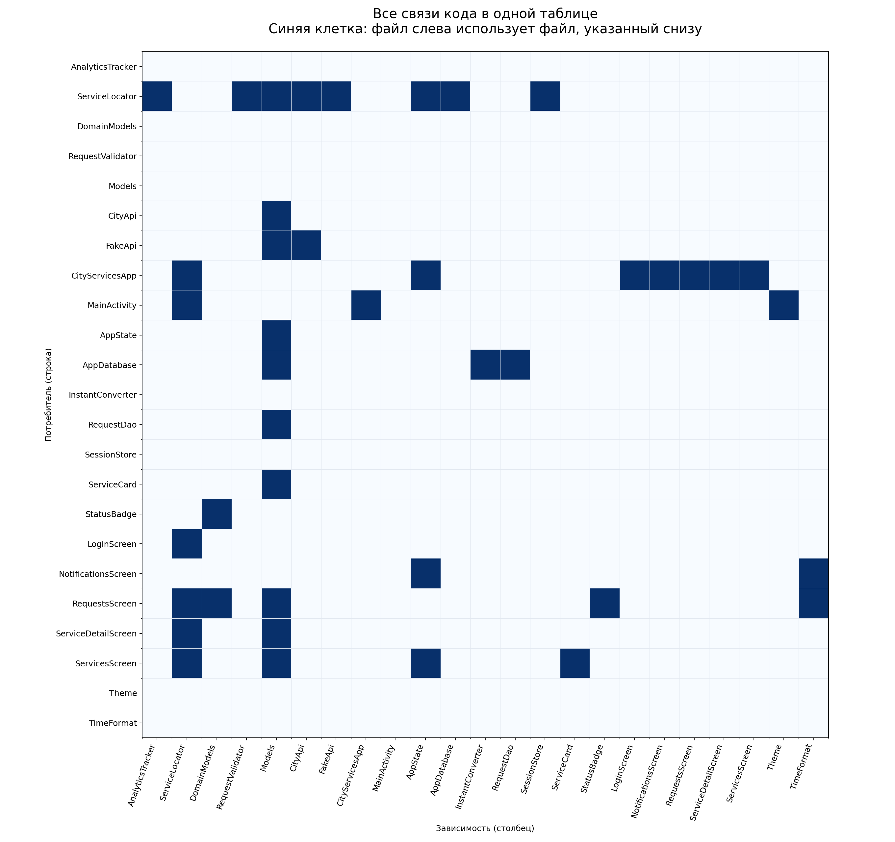

Строка является потребителем, столбец зависимостью. Матрица позволяет проверить каждую связь без пересечения линий большого графа. В отличие от диаграммы компонентов, она строится полностью из извлечённых фактов.

### Как читать обновлённые схемы

Большие графы разделены на карточки: слева указана одна часть приложения, справа перечислено всё, что она использует. Это по-прежнему полный граф, но вершины-получатели повторены, чтобы линии разных участков не пересекались. Часть без исходящих связей также показана. Понятное название объясняет назначение, а имя файла под ним позволяет найти соответствующий код. На схемах работы приложения тот же принцип применяется к обращениям между компонентами и передаче данных. Для общего обзора без повторений сохранена таблица связей на рисунке 10.

### Рисунок 11. Общая схема зависимостей приложения

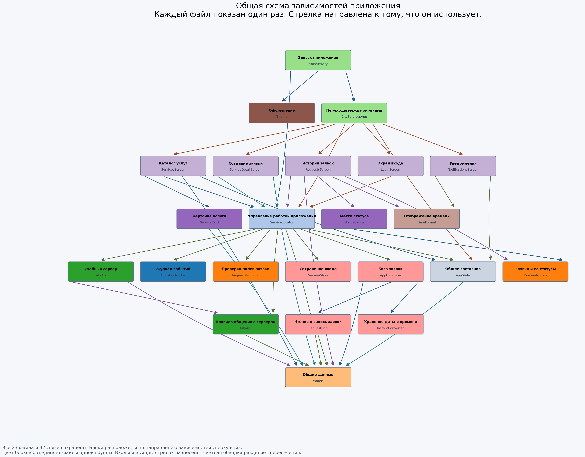

Здесь весь граф снова собран на одном изображении, как в первоначальном варианте: каждый из 23 файлов показан только один раз, все 42 обнаруженные связи сохранены. Стрелка направлена от файла к тому, что он использует. Блоки расположены сверху вниз по порядку зависимостей; их порядок внутри рядов подобран для уменьшения пересечений. Цвет объединяет файлы одного пакета, а понятное название дополнено именем файла.

Общий граф помогает увидеть центральную роль `ServiceLocator` и распространённость общих моделей. Он дополняет, а не заменяет схемы-карточки: на большом графе некоторые линии пересекаются из-за количества связей, поэтому конкретную зависимость удобнее уточнять по карточкам или таблице на рисунке 10. Это статические зависимости кода, а не последовательность выполнения пользовательского сценария.

## 13. Воспроизводимость и файлы результата

Выполнять из корня репозитория:

```powershell
python -m pip install -r mob_curs_docs/stage1/requirements.txt
python mob_curs_docs/stage1/analyze.py
python mob_curs_docs/stage1/verify.py
```

Скрипт не изменяет Android-код. Он перезаписывает только собственные `analysis.json`, `edges.csv` и изображения внутри `stage1/images`. После изменения приложения потребуется также вручную пересмотреть семантические схемы, доказательства и номера строк отчёта: рисунки 1, 5, 8 и 9 заданы по текущему анализу, а не автоматически восстанавливаются из методов. Числовые префиксы имён PNG являются постоянными идентификаторами файлов и не определяют номера рисунков в отчёте.

| Файл | Назначение |
|---|---|
| Этот отчёт | Подробный результат первого этапа |
| `analyze.py` | Извлечение импортов, метрики, проверки циклов и генерация PNG |
| `requirements.txt` | Версии Python-зависимостей генератора |
| `verify.py` | Проверка метрик, оснований связей, ссылок отчёта и целостности PNG |
| `analysis.json` | Инвентарь файлов/объявлений/import, метрики и SCC в машиночитаемом виде |
| `edges.csv` | Потребитель, зависимость, вид основания и конкретное импортируемое/упоминаемое объявление |
| `images/01-imports.png` | Граф явных импортов |
| `images/02-file-dependencies.png` | Расширенный граф файлов |
| `images/03-packages.png` | Граф логических пакетов |
| `images/04-gradle-modules.png` | Физическая модульная структура и внешние зависимости |
| `images/05-model-propagation.png` | Распространение файлов моделей |
| `images/06-coupling-impact.png` | Fan-in и транзитивный радиус влияния |
| `images/07-runtime-components.png` | Семантическая схема компонентов |
| `images/08-request-data-flow.png` | Поток заявки и ошибочный fallback |
| `images/09-dependency-matrix.png` | Полная матрица связей файлов |
| `images/10-architecture-overview.png` | Единая обзорная схема текущей архитектуры |
| `images/11-dependencies-overview.png` | Общий граф всех файлов и зависимостей без повторения блоков |

## 14. Исходные метрики для следующих этапов и ADR

### 14.1. Версия и условия измерений

Замеры выполнены 28.10.2026 UTC (в локальном часовом поясе компьютера уже 29.10.2026). Исходный коммит: `b43f23e52f4c92879777d76bf25da39b65b327a2`. Production-код не изменялся. Для проверки неизменности каждого Kotlin-файла сохранён SHA-256 в `baseline/measurements.json`.

Результаты разделены на три независимые группы: статические показатели исходников, фактический запуск unit-тестов и пробные измерения установленного APK. Последний не пересобирался и его идентичность данному коммиту не установлена, поэтому его время запуска нельзя считать строгим benchmark исходников. Для последующего сравнения производительности следует собирать baseline и новую версию в одинаковом режиме и окружении.

Окружение тестов: Windows amd64, Azul Zulu JDK 21.0.13, Gradle 9.7.1. Локальный путь к JDK не публикуется; для повторения необходимо задать `JAVA_HOME` на собственный JDK 21. `JAVA_HOME` и `PATH` менялись только для процесса запуска, системные настройки и Gradle-конфигурация не изменялись. Предыдущий запуск под Java 16 действительно был заблокирован; приведённый ниже запуск с JDK 21 уже дошёл до тестов.

### 14.2. Структура и границы ответственности

| ID | Показатель | Измеренное исходное значение | Как использовать при сравнении |
|---|---|---|---|
| M01 | Размер production-кода | 23 файла, 1750 строк, 12 пакетов, 1 Gradle-модуль | Контекст изменения; рост или уменьшение сами по себе не означают улучшение |
| M02 | Внутренние связи | 38 импортных, 42 с учётом своего пакета; 21 пара пакетов | Сопоставлять направление связей и ответственность, не добиваться минимума любой ценой |
| M03 | Статические циклы | 0 нетривиальных SCC файлов и пакетов | Сохранить отсутствие циклов |
| M04 | Связанность общих моделей | `Models`: fan-in 10, транзитивных потребителей 14 | Проверить, уменьшилось ли распространение инфраструктурных изменений на UI |
| M05 | Связанность центра операций | `ServiceLocator`: fan-in 6, fan-out 8 | Оценить разделение ответственности, а не просто переименование singleton |
| M06 | Обращения экранного кода к singleton | 10 мест в 5 файлах UI/root composition; вместе с MainActivity — 11 в 6 файлах | При выбранном отказе от глобального доступа ожидается 0 таких обращений |
| M07 | Прямые импорты сети/хранилищ в UI | 0 | Сохранить; исходная проблема в основном транзитивная, не прямой доступ к DAO из composable |
| M08 | Android/AndroidX-импорты в domain | 0 | Сохранить независимость чистых правил |
| M09 | Внешние обращения, изменяющие AppState | 10 синтаксических мест в 2 файлах; отдельно 1 изменение `notification.isRead` в UI | Проверить, установлены ли явные владельцы состояния |
| M10 | Подключение проверки адреса | 0 вызовов `validateAddress` или полного `RequestValidator.validate` вне самого валидатора | После решения о валидации адреса проверить реальный сценарий, не только наличие функции |

Для M06 включены и composable, и ViewModel в файлах `ui/`, а также `CityServicesApp`. Объявленная, но не подключённая `ServicesViewModel` тоже входит в лексический подсчёт; 10 мест — не частота вызовов во время выполнения. M09 считает явно видимые присваивания/операции списка и вызовы `login/reset`, но не все возможные косвенные записи: это индикатор, не доказательство полного списка владельцев. Для каждого совпадения в JSON сохранены файл, строка и выражение.

### 14.3. Проверки контрактов по исходному коду

Следующие результаты получены проверкой структуры кода и ручным сопоставлением, а не полноценным динамическим прогоном отказов. Нулевые дубли или отсутствие потерь из них не выводятся.

| ID | Проверяемое свойство | Исходное состояние | Критерий для следующего этапа |
|---|---|---|---|
| C01 | История ограничена пользователем | Нет: используется `requestDao().all()` | Выборка текущего пользователя и интеграционный тест с двумя аккаунтами |
| C02 | История наблюдает изменения БД | Нет: DAO возвращает snapshot List, не Flow | Изменение записи обновляет открытый экран без повторного входа |
| C03 | Идентичность операции и sync-state | В модели нет operation/idempotency ID и состояния синхронизации | Повтор с тем же ключом не создаёт вторую логическую заявку |
| C04 | Отметка прочтения наблюдаема | `isRead` — обычный Boolean var; найдено 1 прямое изменение в UI | Нажатие немедленно обновляет оформление и счётчик |
| C05 | Инициализация не зависит от recreation Activity | MainActivity вызывает init, init безусловно создаёт FakeApi и Room | Подсчитать создания при recreation: в выбранном application scope по одному за процесс |
| C06 | Черновик сохраняется | В форме нет rememberSaveable/SavedStateHandle | При принятом требовании поля восстанавливаются после recreation |
| C07 | Отмена отделена от ошибок | 4 catch с Exception, явной обработки CancellationException нет | Тест отмены не запускает ошибочный fallback |

Изменение наличия `Flow` или имени поля само по себе не доказывает исправление: после реорганизации эти структурные индикаторы должны дополняться проверкой поведения. Проверка отсутствующих имён C03 ограничена текущей моделью и не является универсальным анализатором offline-first архитектуры.

### 14.4. Фактический запуск unit-тестов

Команда: `.\gradlew.bat testDebugUnitTest --console=plain --stacktrace` с JDK 21. Скрипт повторения: `baseline/run-unit-tests.ps1`. Для публикации сохранены JSON-сводка и четыре XML-отчёта с обезличенным именем компьютера. Необработанные локальные логи stdout/stderr и версии JVM/Gradle не публикуются, поскольку могут содержать пути и сведения об окружении.

| Набор | Выполнено | Успешно | Неуспешно |
|---|---:|---:|---:|
| AnalyticsTrackerTest | 1 | 0 | 1 |
| RequestValidatorTest | 7 | 7 | 0 |
| FakeApiTest | 3 | 1 | 2 |
| TimeFormatTest | 5 | 5 | 0 |
| **Всего** | **16** | **13** | **3** |

Доля успешных тестов: **81,25%** в одном запуске. Пропусков и XML errors — 0; все три неуспеха записаны как failures. Код завершения команды — 1. Это не процент покрытия кода и не оценка стабильности серии.

Подтверждённые причины:

- `AnalyticsTrackerTest`: `Method d in android.util.Log not mocked`, вызов Android Log в local JVM-тесте.
- `FakeApiTest`, ожидание пятой заявки: `Ожидался IOException, но заявка создалась`.
- `FakeApiTest`, четыре успешных создания: `IOException: Тайм-аут запроса`.

Последние два результата согласуются с общим экземпляром FakeApi и зависимостью от порядка тестов. Частоту нестабильности нельзя вычислить по этому одному прогону; результаты последующей серии из пяти повторов приведены в разделе 14.6.2.

Полное wall time команды: **14,406 с**. Gradle сообщил 13 с, 26 задач: 11 executed, 15 up-to-date. Это инкрементальный запуск, не чистая сборка. Сравнивать его следует с таким же инкрементальным запуском, отдельно от clean build. В исходниках обнаружено 4 local test-файла и 16 `@Test`; instrumented Kotlin test-файлов — 0. В первоначальном запуске покрытие не собиралось; последующий JaCoCo-замер приведён в разделе 14.6.1. Дополнительный Android-стенд размещён отдельно и не выдаётся за исходные тесты проекта.

### 14.5. Пробная серия запусков установленного APK

Перед каждой попыткой процесс завершался через `am force-stop`, затем выполнялось `am start -W -n ru.course.cityservices/.MainActivity`. Данные приложения и сессия не очищались. Между запусками выдерживалась пауза 3 с. В `measurements.json` сохранены только модель эмулятора, API, разрешение и измеренные значения; полный package dump и снимок памяти исключены из публикации как избыточные сведения об устройстве. Исходные ответы запуска Android находятся в `baseline/launch-1.txt`–`launch-5.txt`.

| Запуск | Android TotalTime, мс |
|---|---:|
| 1 | 1790 |
| 2 | 1705 |
| 3 | 1811 |
| 4 | 3277 |
| 5 | 1767 |
| **Медиана** | **1790** |
| **Минимум / максимум** | **1705 / 3277** |

Это время запуска Activity по Android, **не** время появления готового каталога, не сетевой latency и не время отрисовки каждого кадра. Процесс запускается заново, но файловые кэши и окружение эмулятора прогреты. Пять наблюдений недостаточны для надёжного p95; он не заявляется. Без идентификации APK и одинаковых условий эта серия служит только разведочным ориентиром, а не доказательством ускорения будущей архитектуры.

### 14.6. Дополнительные измерения исходной версии

Для закрытия первоначального списка выполнены дополнительные эксперименты на независимых копиях коммита `dfb9704407b33641cd2cee13cbc43e0484c68cf4`. Это следующий коммит документации; production-код совпадает с ранее исследованным. Все 23 SHA-256 исходников основного приложения проверяются скриптом `verify_extended.py`. Копии с контрольными изменениями не включались в исходное приложение. Общие правила интерпретации: [методика сравнения](extended-baseline/Методика%20сравнения.md).

#### 14.6.1. Покрытие строк и ветвей

Измерено JaCoCo 0.8.14 по исходным 16 local unit-тестам, включая падающие. Scope: все debug Kotlin production class-файлы, включая сгенерированный Room/Compose байткод, без пользовательских excludes, со стандартными фильтрами компилятора JaCoCo. Это покрытие указанного байткода исходными unit-тестами, а не покрытие instrumented-сценариями стенда.

| Счётчик | Покрыто | Не покрыто | Всего | Доля |
|---|---:|---:|---:|---:|
| LINE | 156 | 900 | 1056 | 14,7727% |
| BRANCH | 21 | 151 | 172 | 12,2093% |

Счётчик LINE относится к исполняемым строкам отчёта JaCoCo и не должен сравниваться напрямую с 1750 физическими строками Kotlin. Во всех пяти прогонах агрегированные счётчики одинаковы. Выполненные строки падающего теста дают coverage, но не доказывают правильность поведения. Доказательства и настройки: [testing/RESULTS.md](extended-baseline/testing/RESULTS.md), `testing/summary.json`, XML JaCoCo и скрипты повторения.

#### 14.6.2. Повторяемость тестов

Выполнены пять реальных запусков test task без пропуска по up-to-date или кэшу; компиляция при повторах оставалась актуальной.

| Прогон | Успешных | Неуспешных | Сумма времени test cases, с | Wall time Gradle, с |
|---|---:|---:|---:|---:|
| 1 | 13 | 3 | 4,817 | 15,860 |
| 2 | 13 | 3 | 4,908 | 8,925 |
| 3 | 13 | 3 | 4,872 | 59,480 |
| 4 | 13 | 3 | 5,026 | 12,051 |
| 5 | 13 | 3 | 4,829 | 9,521 |

Наблюдаемая смена исхода pass/fail: **0 из 16 тестов**. Неуспешных выполнений: **15 из 80, 18,75%**. Это три одинаково воспроизводимых падения по 5/5, **не 18,75% flakiness**. Причины те же, что в разделе 14.4: Android Log и два теста FakeApi с общим состоянием. Пять запусков с одинаковым порядком не доказывают независимость от случайного порядка. Wall time включает JaCoCo и конкуренцию за ресурсы компьютера; скачок третьего запуска не следует приписывать коду приложения. Полная таблица каждого теста: `testing/test-cases.csv`.

#### 14.6.3. Отказы, повторы и изоляция пользователей

Из исходников собрана отдельная debug-копия `ru.course.cityservices.baseline` для Android API 34. Production-файлы сверены по хешам; изменены только applicationId и настройки instrumented-тестов. Исходное установленное приложение и его данные не очищались. Выполнены три успешных instrumented-прогона. Используются реальные `ServiceLocator`, Room и UI; API подменён управляемым `CityApi`, чтобы воспроизводить конкретный отказ, а не ждать случайного события.

| Эксперимент | Фактический результат | Вывод |
|---|---|---|
| Ответ потерян после серверной записи | В каждом из 3 прогонов: 1 серверная запись, 2 локальные записи одной отправки | 1 лишняя локальная копия; дефект воспроизведён 3/3 |
| Отказ до серверной записи, затем восстановление API | После 5 refresh: 0 серверных записей, 1 локальная запись, create вызван только 1 раз | 1 недоставленное намерение; автоматической повторной отправки нет |
| История двух пользователей | Из 10 строк, по 5 каждому, рабочее чтение пользователя 1 вернуло 5 чужих | Нарушение изоляции запроса подтверждено на реальной Room; это не сценарий входа вторым аккаунтом через demo UI |
| Два одновременных refresh | 144 из 150 опытов создали повторные уведомления; 294 уведомления на 150 изменений | 96% опытов данного конкурентного fixture дали дубли; это не вероятность гонки в обычной эксплуатации |

Во втором опыте локальная запись **не потеряна и не удалена**: теряется гарантия автоматической доставки на сервер. Постоянная безвозвратная потеря данных не утверждается. В конкурентном опыте два вызова реального refresh отпускаются общим барьером в IO-coroutine; production-код и DAO не снабжались искусственными задержками. Точное расписание потоков влияет на частоту гонки.

#### 14.6.4. История на 100 и 1000 заявок

Для каждого размера в трёх instrumented-прогонах подготовлена фиксированная база. Время засева не включено в таймер. API возвращает те же записи без искусственной сетевой задержки; тем самым измеряется локальный путь, а не стандартные 600 мс FakeApi. В каждом прогоне выполнено 10 чтений DAO на размер, всего 30. UI-таймер заканчивается при обнаружении ожидаемого текста первой заявки, а не после отображения всех записей LazyColumn.

| Размер | Медиана 30 чтений DAO, мс | Три появления первой карточки, мс | Медиана UI, мс |
|---|---:|---|---:|
| 100 заявок | 3,245 | 350,83 / 520,00 / 519,19 | 519,19 |
| 1000 заявок | 15,614 | 489,51 / 848,87 / 559,62 | 559,62 |

Это debug-результат на одном эмуляторе. UI-значения включают наблюдение UiAutomator и соответствующий путь открытия истории; они не равны чистому времени SQL. Десятикратный рост базы не означает, что UI должен отрисовать в десять раз больше карточек одновременно.

#### 14.6.5. Готовность экрана, кадры и память

В трёх instrumented-прогонах получены времена появления входа 2183,42 / 1953,84 / 1961,38 мс (медиана 1961,38 мс) и каталога после нажатия входа 2651,00 / 2626,00 / 2595,22 мс (медиана 2626,00 мс). Отдельно выполнены пять запусков нового процесса с наблюдением UI через ADB: медиана видимого входа **4826,57 мс**. Эти две серии имеют разные границы и накладные расходы; объединять их нельзя. Вторая включает команды ADB и UI dump, поэтому не является чистым cold-start benchmark. В отличие от раздела 14.5, измерительный APK здесь действительно собран из проверенных исходников.

Для 1000 заявок выполнены вход на экран и 20 жестов прокрутки в каждом из трёх прогонов. По `gfxinfo` доля janky frames: **15,89% / 11,08% / 12,41%**. Интервал включает вход на экран и прокрутку, а не только установившийся scrolling. Поэтому это исходный индикатор данного сценария, не общая характеристика всех экранов и не release-производительность.

Изменение общего PSS после 20 циклов навигации в одном процессе: **−5124 / −2326 / +800 КБ** в трёх прогонах. Принудительный GC не вызывался. Устойчивый рост на этой короткой нагрузке не подтверждён; наличие утечки также не доказано и не опровергнуто. Сохранены точки до и после циклов, а не выдан одиночный снимок памяти за рост.

Результаты и точные определения всех таймеров: [runtime/methodology.json](extended-baseline/runtime/methodology.json). В `runtime/results` находятся JSON исходных значений, агрегаты кадров, пять наблюдений запуска и обезличенные логи instrumented-тестов. `BaselineRuntimeTest.kt` и `run-runtime.ps1` позволяют повторить тот же fixture на следующей версии; package и его данные изолированы от основного приложения.

#### 14.6.6. Реальная стоимость контрольных изменений

Упражнения выполнены независимо, каждое от неизменённого baseline, а не последовательно поверх другого. Неизменённая копия и обе изменённые копии успешно прошли `:app:compileDebugKotlin`, включая KSP/Room.

| Упражнение | Изменённых файлов | Добавлено строк | Удалено строк | Сумма изменений | Подсистем |
|---|---:|---:|---:|---:|---:|
| A: необязательное поле `locationHint` | 7 | 43 | 5 | 48 | 5 |
| B: статус `REJECTED` / «Отклонена» | 3 | 16 | 10 | 26 | 3 |

В A поле проведено через API, пути FakeApi, Room-модель, orchestration, форму и историю; добавлена миграция 1→2 с `ALTER TABLE requests ADD COLUMN locationHint TEXT`. Это проверка компиляции, не выполненный тест runtime-миграции. Утверждение о сохранности всех реальных БД из неё не делается.

В B добавлены терминальный статус, переход из «Создана», использование доменного правила в FakeApi и оформление badge. Экран фильтров не потребовал правки, поскольку список строится из enum. Сумма строк — добавления плюс удаления без шума CRLF/LF; длительность работы разработчика не измерялась. Патчи, точные списки файлов и правила подсчёта: [методика контрольных изменений](extended-baseline/change-impact/methodology.md), `change-impact/measurements.json`, `exercise-a.patch`, `exercise-b.patch`.

#### 14.6.7. Закрытие списка исходных измерений

| Исходный пункт | Полученное доказательство |
|---|---|
| Дубли и недоставка при отказах | 3 Android-прогона управляемых отказов, реальные orchestration и Room |
| Межпользовательская изоляция | Fixture двух пользователей; 5 чужих из 10 строк |
| Покрытие | LINE 156/1056, BRANCH 21/172, JaCoCo XML |
| Повторяемость тестов | 5 реальных запусков, 80 test executions, 0 наблюдаемых смен исхода |
| История 100/1000 | По 30 DAO-чтений и по 3 UI-открытия на размер |
| Готовность, кадры, память | Измерительный APK, таймеры видимого содержимого, gfxinfo и PSS до/после 20 циклов |
| Контрольные изменения | Два независимых патча, точные diff и успешная компиляция |

Все категории первоначального списка получили фактические измерения. Это закрывает объём baseline первого этапа, **но не означает исправление дефектов или доказанное отсутствие всех возможных проблем**. Ограничения окружения, небольших выборок и подмен отражены рядом с результатами. Проверка полноценного backend, промышленная аттестация и runtime-валидация миграции экспериментального поля не входят в измерение стоимости контрольного изменения. Следующие этапы должны повторить тот же стенд и показать изменение этих результатов, а не только новый вид схемы архитектуры.

### 14.7. Использование исходных метрик в ADR

| Будущее решение | Исходное основание | Проверяемый эффект |
|---|---|---|
| Явные зависимости и разделение ServiceLocator | M05–M06: fan-out 8; 11 глобальных вызовов presentation-кода | Отсутствие прямого singleton-доступа, возможность подмены зависимостей в тестах |
| Один наблюдаемый источник истории | C02: List snapshots | Обновление статуса на открытом экране без навигации |
| Идемпотентная отправка и sync-state | C03, проблема A02 | Одна логическая заявка после timeout и повторов, отсутствие потерь |
| Область жизни инфраструктуры | C05 | Один экземпляр инфраструктуры за процесс, сохранность после recreation |
| Модель UI-state и ошибок | M09, C04, C07 | Единственный владелец состояния, немедленное unread, корректная отмена |
| Изоляция пользователей и валидация | M10, C01 | Пустой адрес отклоняется; история не содержит чужих данных |
| Изоляция Android-зависимостей тестов | 3 failures из 16, включая Android Log | Все исходные корректные проверки проходят, новая серия воспроизводима |

В каждом ADR следует указывать исходную метрику, ожидаемый результат, метод проверки и принятый компромисс. Например, выделение интерфейса может увеличить число файлов и рёбер, но устранить зависимость UI от конкретного singleton. Это допустимый результат, если сценарии и тестируемость действительно улучшились.

### 14.8. Повторение измерений

```powershell
python mob_curs_docs/stage1/analyze.py
python mob_curs_docs/stage1/measure_baseline.py
powershell.exe -NoProfile -ExecutionPolicy Bypass -File mob_curs_docs/stage1/baseline/run-unit-tests.ps1
```

Для новой серии запусков установленного APK использовать `python mob_curs_docs/stage1/measure_baseline.py --device`. Команда перезапускает процесс приложения пять раз и не очищает его данные. Без `--device` повторяются только исходные лексические проверки, а ранее полученная серия устройства сохраняется с исходной отметкой времени. Скрипт записывает результаты в `baseline/`; перед замерами следующего этапа текущий комплект следует сохранить как baseline в Git, а новые результаты размещать отдельно, чтобы не потерять исходные значения.

## 15. Итог первого этапа

Исходное приложение разделено на читаемые технические пакеты и не содержит обнаруженных статических циклов. В нём есть полезные чистые функции, API-интерфейс и типизированные доменные статусы. Однако эти элементы пока не образуют последовательных архитектурных границ.

Основные проблемы: концентрация сценариев в `ServiceLocator`, общая модель сети/диска/UI, несколько несогласованных владельцев состояния и недостаточно определённый контракт синхронизации. Наиболее существенны сброс инфраструктуры при recreation, дубли после неопределённого результата отправки, отсутствие пользовательской изоляции выборки и наблюдаемого обновления истории.

Полученные графы, метрики и реестр проблем достаточны как фактическая основа для следующего этапа: формирования 6-8 содержательных ADR. Выбор конкретного шаблона архитектуры не предрешён результатами исследования и должен быть обоснован требованиями и обнаруженными проблемами.
