# Пользовательские истории и пошаговые сценарии

## Назначение и источник изображений

Приложение в рамках курсовой предназначено для **РУТ (МИИТ) — Российского университета транспорта**. `RUT MIIT` — обозначение университета, а не имя жителя. Пользовательские истории описаны от лица пользователя университета; конкретное разделение на студентов, сотрудников и другие роли в исходном приложении не реализовано.

Документ дополняет первый этап исследования: он показывает, какие задачи решает пользователь РУТ (МИИТ) и как эти задачи выполняются в существующем приложении. Это описание исходного поведения, а не проект нового интерфейса. Названия «Городские услуги», «Личный кабинет жителя», городские категории и адреса на скриншотах сохранены из исходного учебного проекта. Они не означают, что приложение предназначено для муниципалитета, и пока не адаптированы под университет. Отдельные роли исполнителей и маршрутизация заявок службам университета также пока отсутствуют.

Изображения получены 28.10.2026 из **реально запущенного приложения** `ru.course.cityservices` на подключённом Android-эмуляторе `emulator-5554`, разрешение 1080 × 2220. Использован уже установленный экземпляр приложения; новая сборка в ходе съёмки не выполнялась, идентичность APK конкретному git-коммиту не проверялась. Тексты и переходы сопоставлены с исходниками экранов. Прежнее ограничение запуска Gradle из-за Java 16 относится к сборке из исходников и не мешает запуску ранее установленного APK.

Снимки интерфейса не перерисованы. На копии добавлены красная рамка, указатель и пояснение справа. Неизменённые оригиналы сохранены в `originals/`, изображения с пометками — в `images/`. Снимок может показывать состояние до действия или его результат; это прямо указано в описании шага. Одно состояние иногда используется в разных историях с разными пометками.

Во время демонстрации создана учебная заявка с комментарием `Snow on the sidewalk near house 12` и адресом `Lenina 12`. Латиница использована для воспроизводимого ввода через ADB; обычный пользователь может вводить русский текст. Реального обращения в городские службы не отправлялось: приложение использует FakeApi. Идентификаторы, время, счётчик уведомлений и статусы на следующих запусках могут отличаться.

## Список историй

| ID | Задача пользователя РУТ (МИИТ) | Результат |
|---|---|---|
| US-01 | Войти в приложение | Открыт личный каталог |
| US-02 | Выбрать подходящую услугу | Изучено описание услуги |
| US-03 | Сообщить о проблеме | Заявка появилась в истории |
| US-04 | Отследить обращения | Просмотрена история и выбран фильтр |
| US-05 | Узнать об изменении статуса | Прочитано уведомление |
| US-06 | Завершить сеанс | Открыт экран входа |
| US-07 | Продолжить работу после перезапуска | Вход восстановлен без пароля |
| US-08 | Исправить незаполненную заявку | Понятна причина ошибки и способ исправления |
| US-09 | Исправить незаполненные данные входа | Пользователь заполнил оба поля |

## US-01. Войти в личный кабинет

**История:** как пользователь РУТ (МИИТ), я хочу войти в личный кабинет, чтобы пользоваться услугами и просматривать свои обращения.

**Предусловие:** приложение открыто, сохранённой сессии нет. Демо-доступ: имя `RUT`, пароль `RUT`, регистр важен.

### Шаг 1. Заполнить данные входа

Нажать «Заполнить демо-доступ». Альтернатива: ввести `RUT` в поля «Имя пользователя» и «Пароль» вручную. Эта кнопка только заполняет поля.

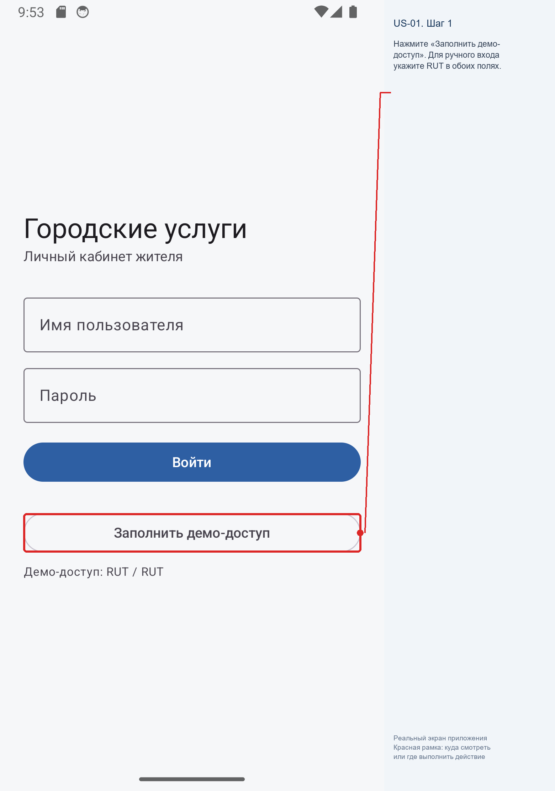

### Шаг 2. Подтвердить вход

Нажать «Войти» и дождаться завершения запроса. Во время ожидания повторное нажатие недоступно.


### Шаг 3. Проверить результат

Убедиться, что появились приветствие «Здравствуйте, RUT MIIT» и каталог. Повторно вводить данные не нужно.

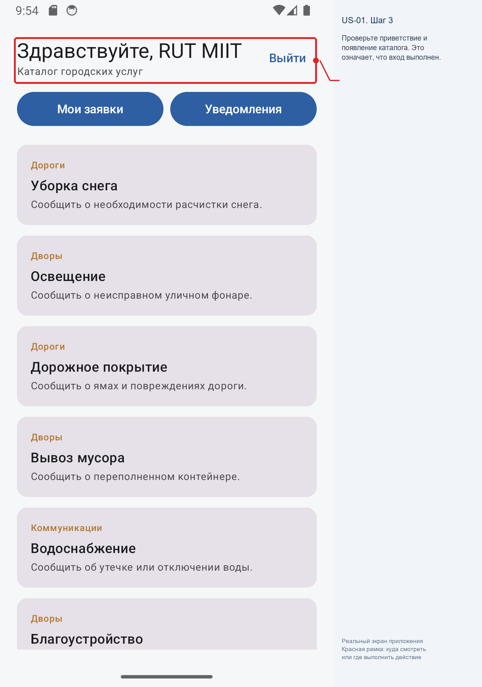

**Критерий выполнения:** открыт каталог авторизованного пользователя. При неверных данных приложение показывает ошибку, а не открывает каталог.

## US-02. Найти подходящую услугу

**История:** как пользователь РУТ (МИИТ), я хочу выбрать услугу и прочитать её описание, чтобы направить обращение по нужной теме.

**Предусловие:** выполнен вход, открыт каталог.

### Шаг 1. Выбрать карточку

Просмотреть список, при необходимости прокрутить его. Для примера нажать всю карточку «Уборка снега». Отдельной кнопки «Подробнее», поиска или фильтра категорий в приложении нет.

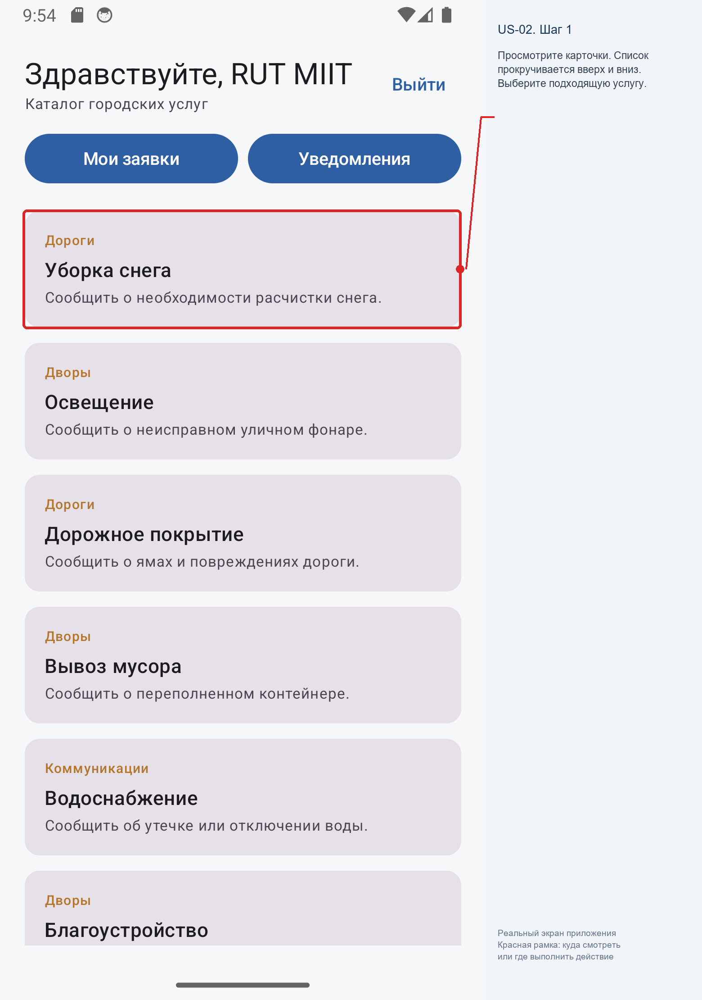

### Шаг 2. Прочитать описание

Проверить название, категорию «Дороги» и описание. Ниже уже находится форма обращения.

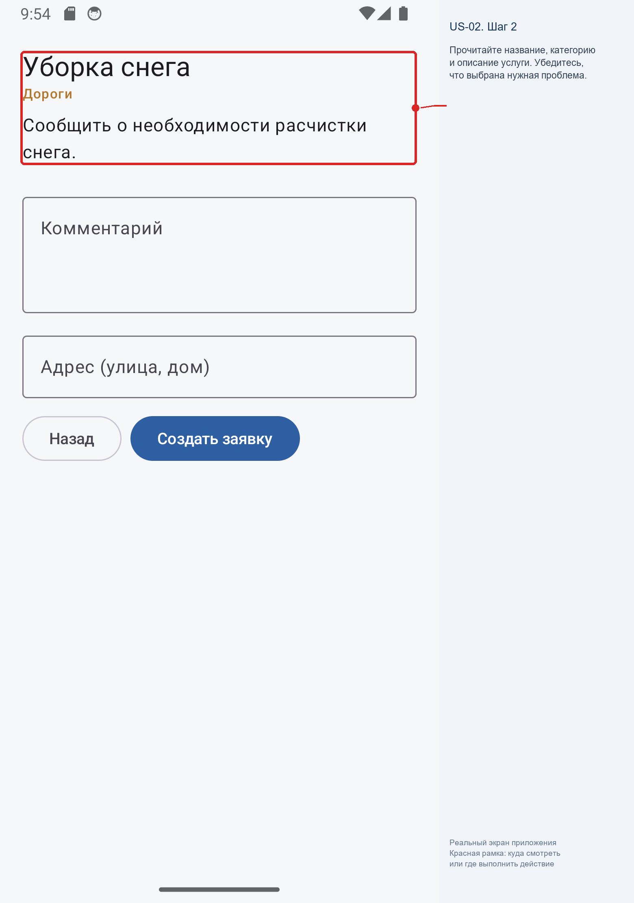

### Шаг 3. Вернуться, если выбрана не та тема

Нажать экранную кнопку «Назад». Снова откроется каталог, где можно выбрать другую услугу. Если тема подходит, вместо возврата перейти к US-03.

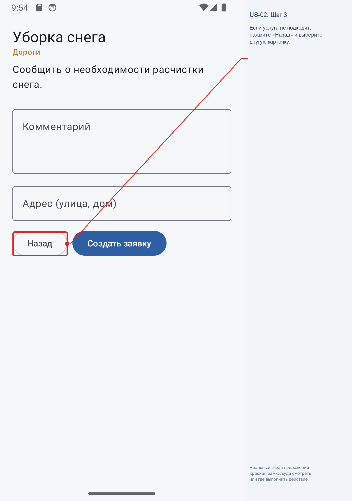

**Критерий выполнения:** пользователь понимает назначение услуги и может начать оформление либо вернуться к выбору.

## US-03. Создать заявку

**История:** как пользователь РУТ (МИИТ), я хочу отправить описание проблемы и её местоположение, чтобы зарегистрировать обращение для последующего решения ответственными службами университета. В текущем прототипе демонстрируется регистрация заявки в FakeApi, а не реальная доставка исполнителю.

**Предусловие:** открыта услуга «Уборка снега». Пример для ручного ввода: «Тротуар у дома 12 не расчищен третий день», адрес «ул. Ленина, 12».

### Шаг 1. Описать проблему

Нажать поле «Комментарий» и ввести конкретное описание длиной не менее 10 символов. Указать, что произошло и где именно нужна помощь.

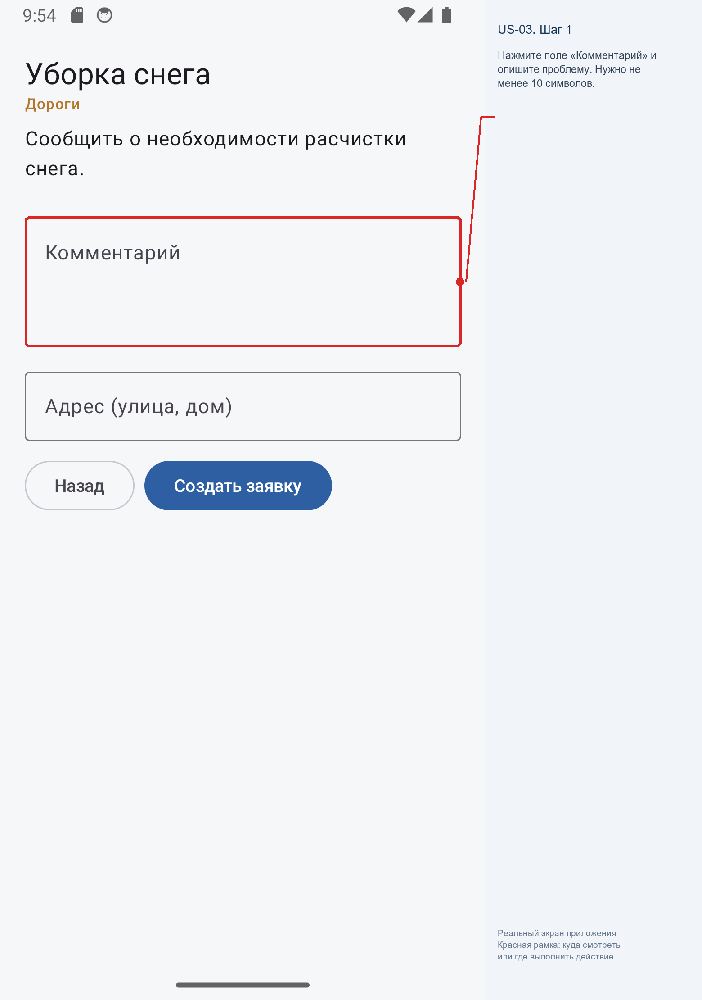

### Шаг 2. Указать адрес

Нажать «Адрес (улица, дом)» и ввести улицу и номер дома. На снимке комментарий уже заполнен. После ввода при необходимости скрыть клавиатуру системной кнопкой Back; для переходов между экранами использовать экранное «Назад».

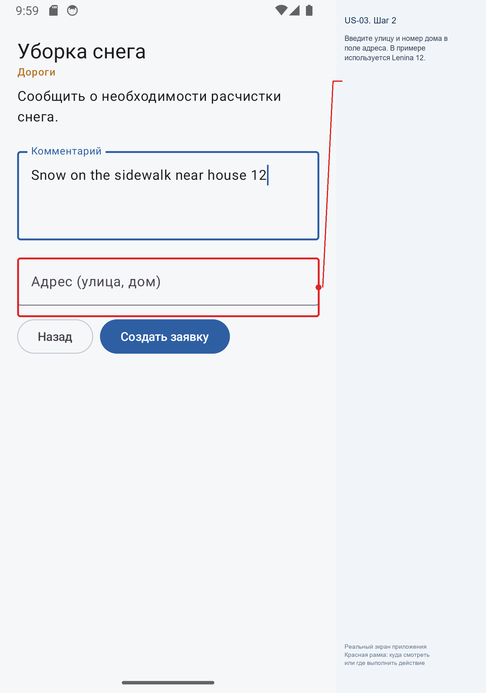

### Шаг 3. Отправить обращение

Проверить оба поля и нажать «Создать заявку». Дождаться окончания отправки; повторно нажимать кнопку не требуется.

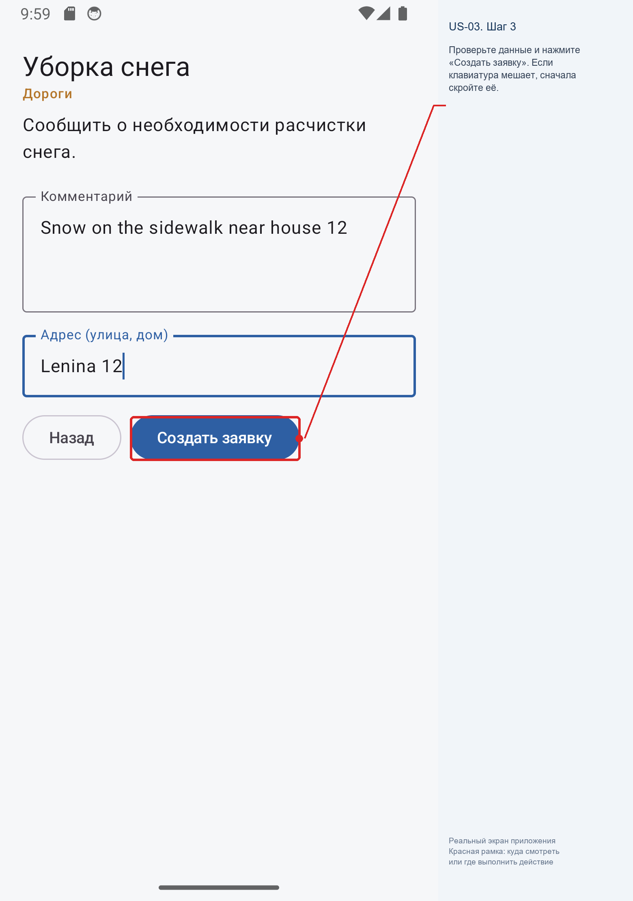

### Шаг 4. Найти созданную заявку

При успехе автоматически открывается «Мои заявки». Проверить комментарий, адрес и номер новой записи. В демонстрации получен номер 100005; в другом запуске он может отличаться.

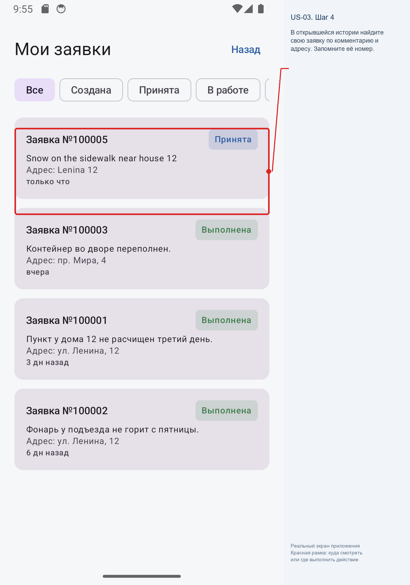

**Критерий выполнения:** обращение появилось в истории. Отдельного окна «Успешно создано» нет. Начальный статус — «Создана», но при автоматическом обновлении он уже может смениться.

**Альтернативный исход:** при ошибке отправки форма остаётся открытой, показывается «Не удалось отправить заявку. Заявка сохранена локально.». Это не эквивалент гарантированной доставки. Не следует бесконтрольно повторять отправку: исходная реализация способна создавать дубли после потери ответа. Этот случай установлен по коду, отдельный снимок сетевой ошибки в данном комплекте не получен.

## US-04. Посмотреть историю и отобрать заявки

**История:** как пользователь РУТ (МИИТ), я хочу видеть статусы обращений и отбирать нужные, чтобы понимать ход выполнения.

**Предусловие:** выполнен вход. В базе могут быть учебные и ранее созданные обращения.

### Шаг 1. Открыть историю

В каталоге нажать «Мои заявки» и дождаться загрузки.

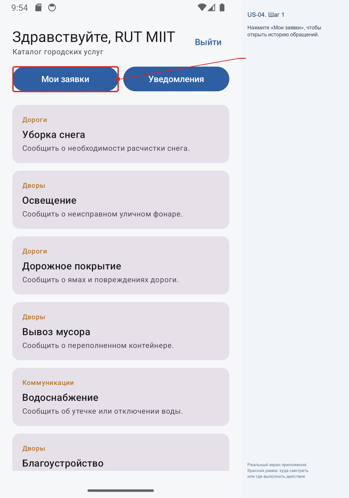

### Шаг 2. Прочитать карточки

Посмотреть номер, статус, описание, адрес и время. Новые обращения расположены выше старых. Карточка не открывает отдельную страницу заявки; редактирование и удаление не предусмотрены.

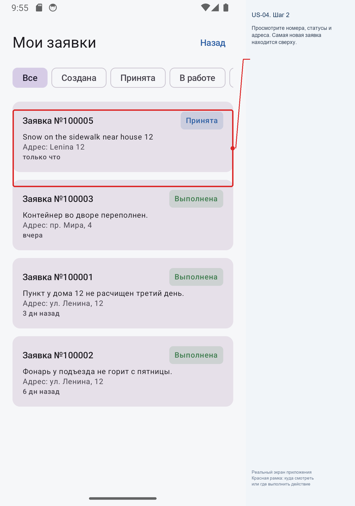

### Шаг 3. Выбрать статус

Нажать «В работе». Доступны «Все», «Создана», «Принята», «В работе», «Выполнена»; строка прокручивается горизонтально.

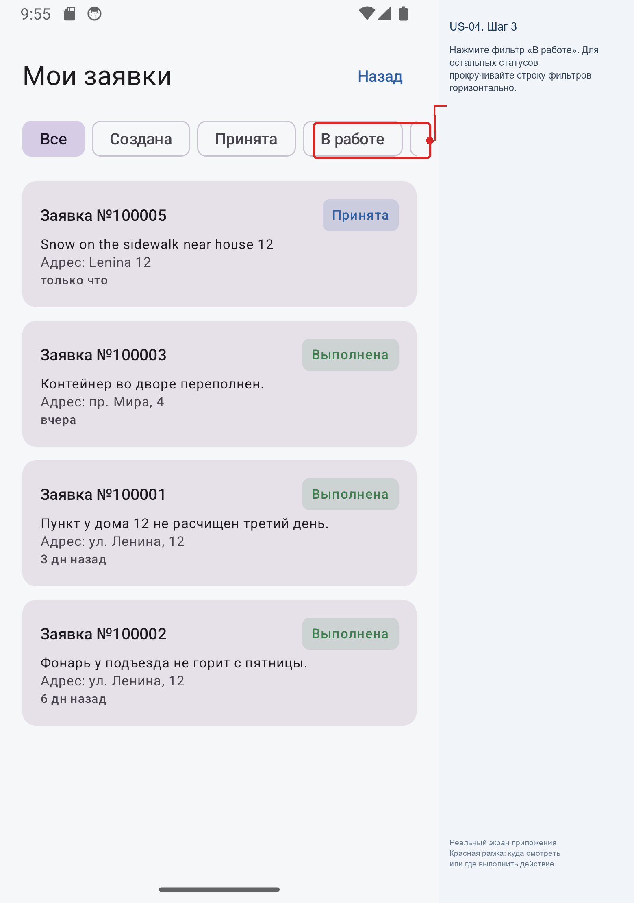

### Шаг 4. Проверить отобранный список

Просмотреть результат. На реальном снимке подходящих заявок не оказалось, поэтому показано «Заявок пока нет». Это означает пустой результат фильтра, а не удаление всей истории.

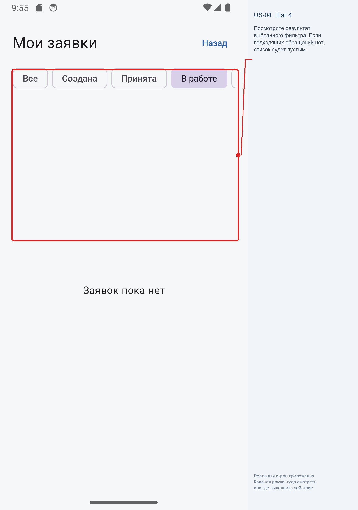

### Шаг 5. Вернуть полный список

Нажать «Все». На снимке показан результат возврата полного списка. Для выхода в каталог использовать «Назад» вверху справа.

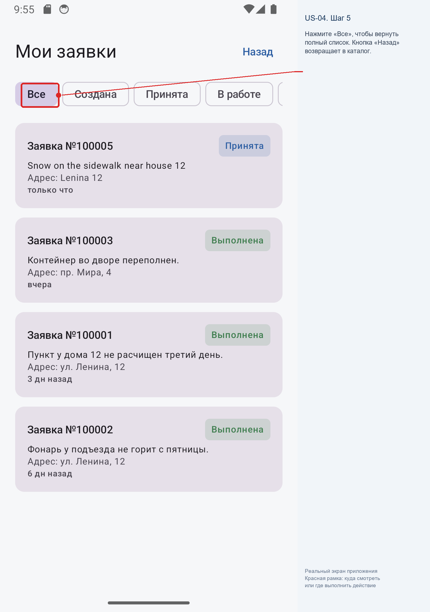

**Критерий выполнения:** выбранный фильтр определяет видимые карточки, «Все» возвращает остальные. Известное ограничение: открытый экран не всегда автоматически отображает обновления БД; для перечитывания следует вернуться в каталог и открыть историю снова.

## US-05. Прочитать уведомление

**История:** как пользователь РУТ (МИИТ), я хочу узнать об изменении статуса обращения, чтобы не пропустить результат его рассмотрения.

**Предусловие:** история ранее загружена, у уже известной заявки изменился статус при очередном обновлении. Изменения в FakeApi случайны, поэтому время появления сообщения не гарантируется. Опрос выполняется примерно каждые 30 секунд при активной композиции приложения.

### Шаг 1. Открыть уведомления

В каталоге нажать «Уведомления» или «Уведомления (N)». Если сообщений ещё нет, появится «Уведомлений пока нет»; для этой истории снято состояние с полученными сообщениями.

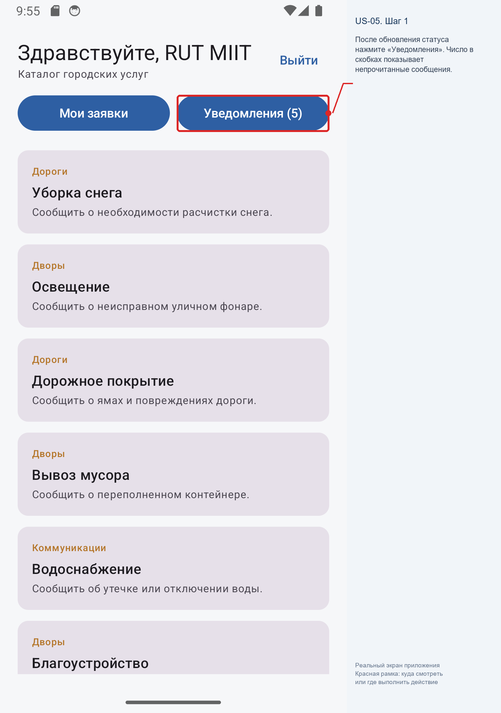

### Шаг 2. Прочитать изменение

Найти сообщение по номеру заявки и прочитать старый и новый статус. На снимке видно изменение заявки 100005: «Создана → Принята».

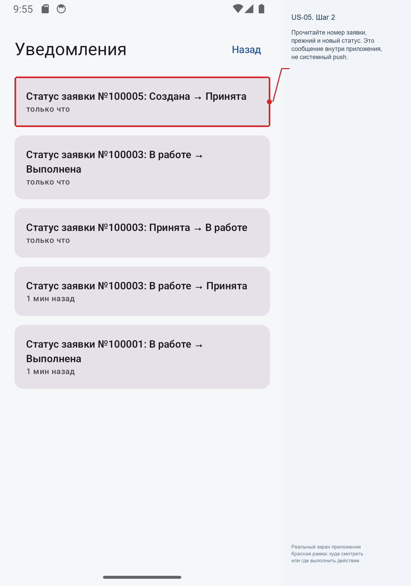

### Шаг 3. Отметить прочитанным

Нажать карточку уведомления. Она не открывает заявку. Из-за дефекта наблюдаемости `isRead` жирность текста и счётчик могут не измениться немедленно; снимок не выдаётся за доказательство исправления этого дефекта.

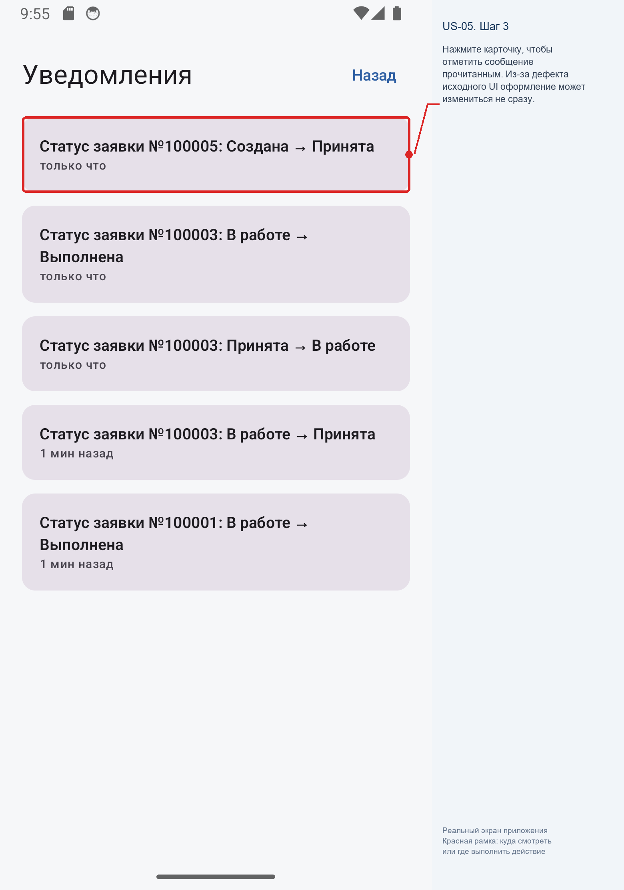

### Шаг 4. Вернуться в каталог

Нажать «Назад» вверху справа.

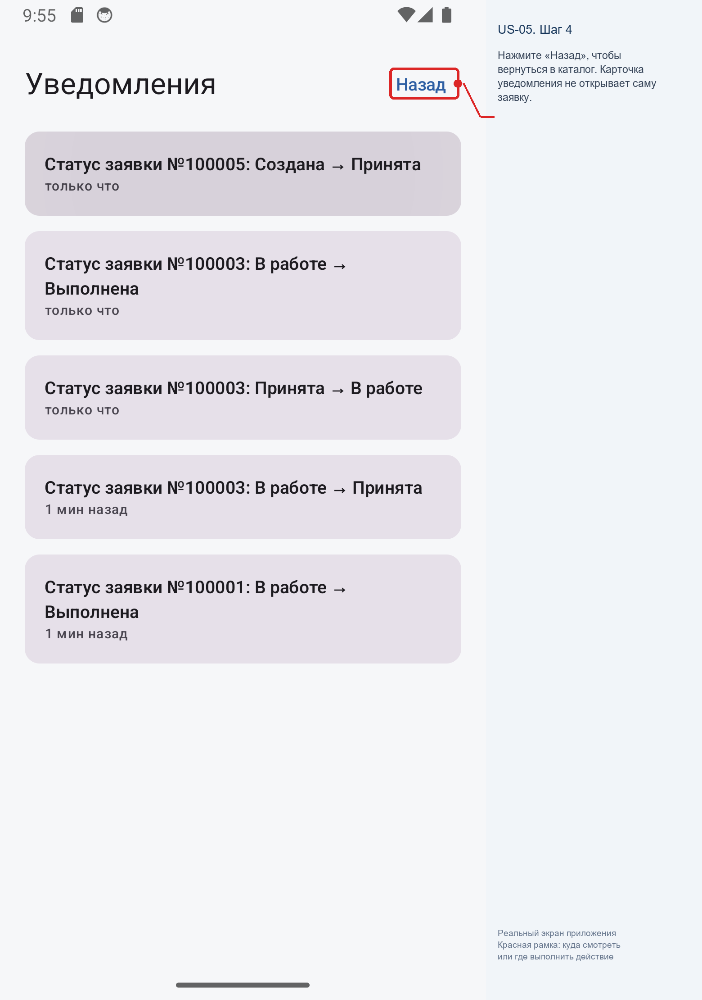

**Критерий выполнения:** пользователь прочитал изменение и выполнил отметку. Это внутриприложные сообщения, не push. Они хранятся только в памяти и теряются после выхода или перезапуска процесса.

## US-06. Выйти из аккаунта

**История:** как пользователь РУТ (МИИТ), я хочу завершить сеанс, чтобы следующий пользователь не работал под моим именем.

**Предусловие:** открыт каталог после входа.

### Шаг 1. Завершить сеанс

Нажать «Выйти» вверху справа. Диалог подтверждения не предусмотрен.

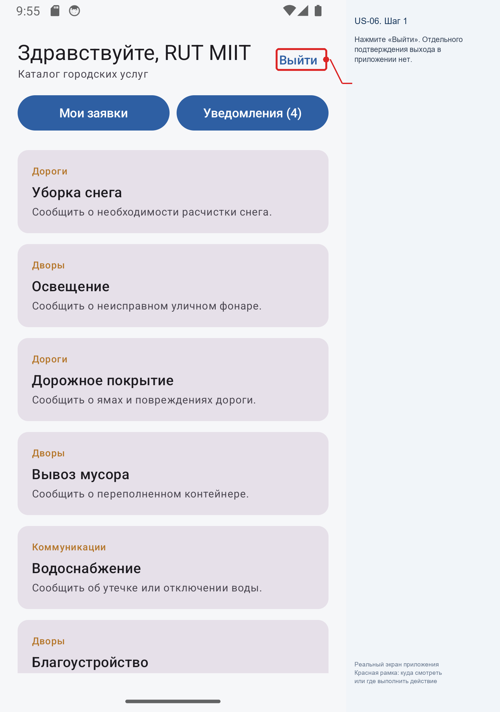

### Шаг 2. Проверить завершение

Убедиться, что показан экран входа с пустыми полями.


**Критерий выполнения:** для новой сессии требуется вход. Ограничение безопасности: локальная база заявок при выходе не очищается, а исходная выборка истории не ограничена текущим пользователем. Поэтому данная история не является доказательством полной межпользовательской изоляции.

## US-07. Продолжить работу после перезапуска

**История:** как пользователь РУТ (МИИТ), я хочу не вводить пароль при каждом открытии приложения, чтобы быстрее продолжить работу.

**Предусловие:** вход успешно выполнен и данные сессии сохранены.

### Шаг 1. Оставить вход активным

Находясь в каталоге, не нажимать «Выйти».

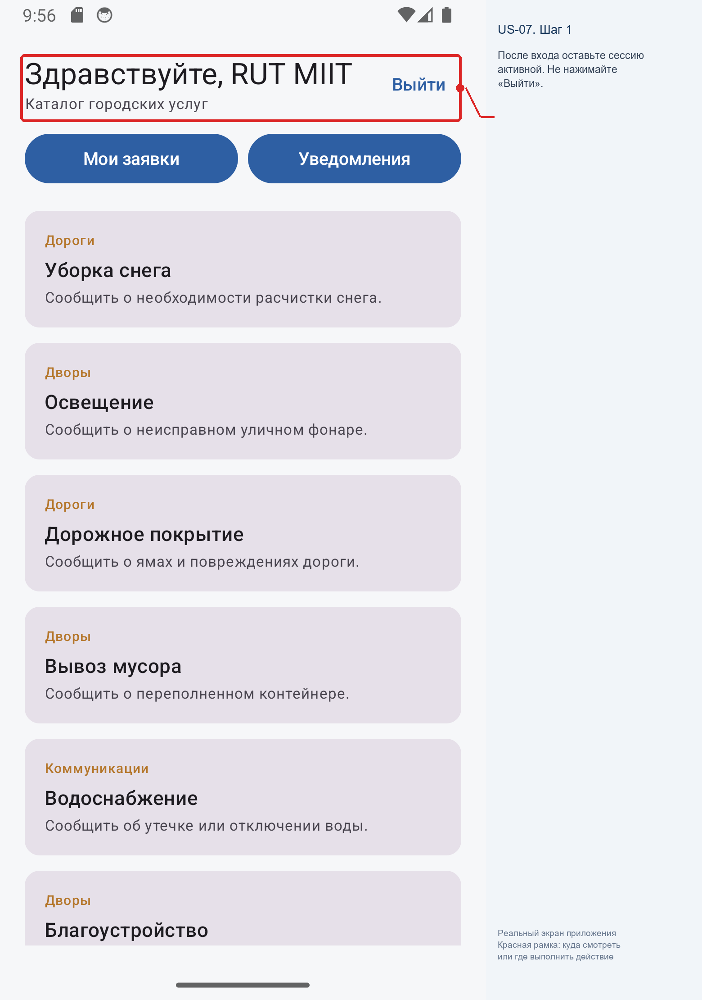

### Шаг 2. Закрыть и снова открыть приложение

Завершить приложение и запустить снова, не удаляя его данные. На картинке отмечено исходное состояние перед закрытием; это не изображение системного меню. При проверке использованы `am force-stop` и повторный запуск Activity, а не очистка данных.


### Шаг 3. Проверить восстановление

Дождаться открытия каталога без ввода пароля. На снимке показан результат реального перезапуска процесса.

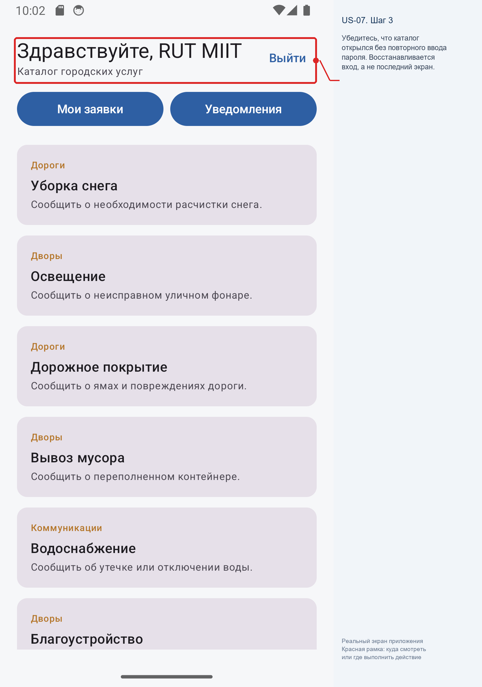

**Критерий выполнения:** пользователь снова видит каталог. Восстанавливается локальная сессия без серверной проверки токена; последний маршрут и черновик формы не восстанавливаются. FakeApi после перезапуска теряет память, хотя локальная база остаётся.

## US-08. Исправить пустой комментарий

**История:** как пользователь РУТ (МИИТ), я хочу понять ошибку заполнения, чтобы исправить заявку до отправки.

**Предусловие:** открыта форма услуги, комментарий пустой.

### Шаг 1. Попробовать отправить пустую форму

Нажать «Создать заявку», оставив комментарий пустым. Это проверка альтернативного сценария, не рекомендация для обычной отправки.

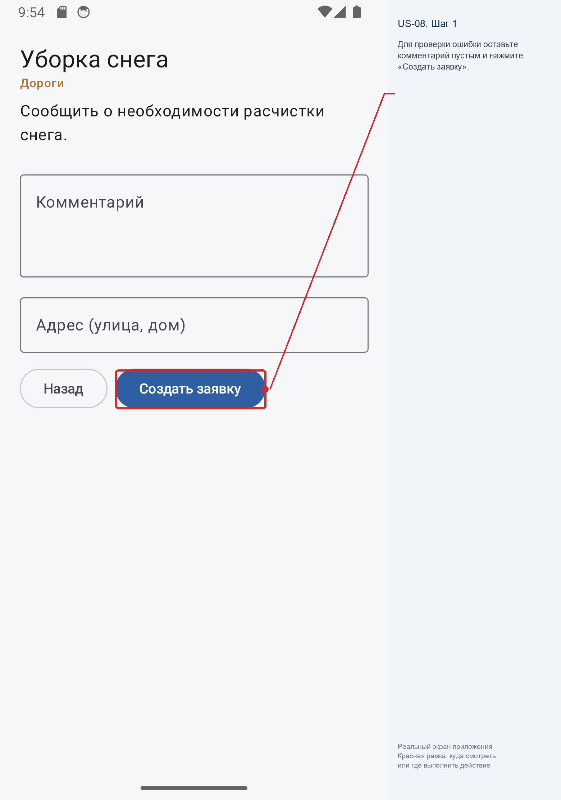

### Шаг 2. Прочитать ошибку и заполнить поля

Появляется «Введите комментарий». Ввести описание не менее 10 символов и адрес. Для слишком короткого текста предусмотрено «Комментарий слишком короткий (минимум 10 символов)»; это отдельное условие установлено по исходникам.

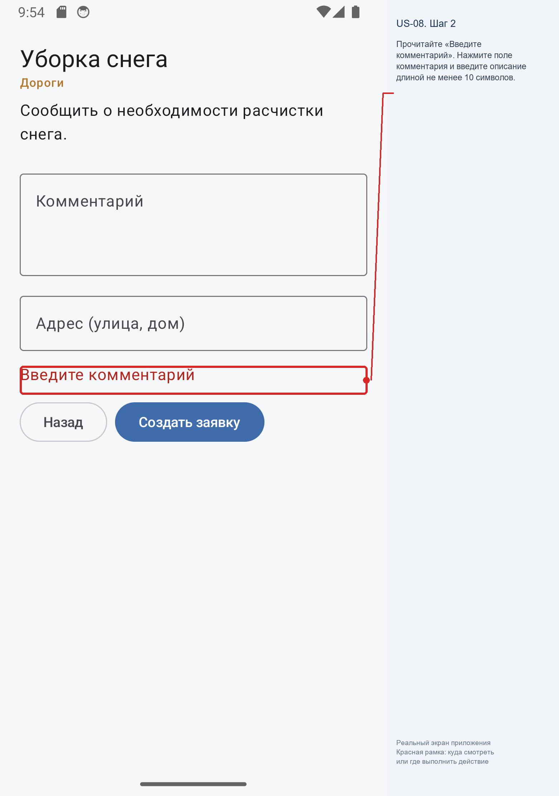

### Шаг 3. Повторить отправку после исправления

Проверить данные и снова нажать «Создать заявку». На снимке заполненные поля ещё соседствуют со старой ошибкой: она не исчезает при наборе текста, а очищается при новой попытке. После успешной отправки проверять результат по US-03, шаг 4.

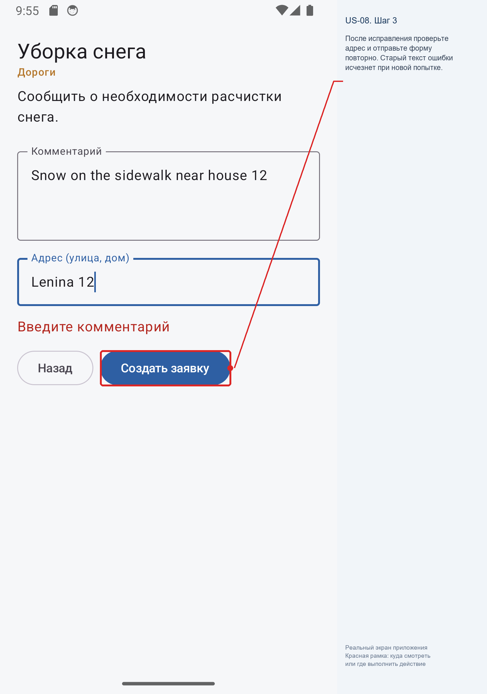

**Критерий выполнения:** пустой комментарий не отправляется, исправленное описание проходит эту проверку. Важно: проверка пустого адреса в исходном сценарии не подключена; наличие поля адреса не означает, что приложение действительно запрещает его пропустить.

## US-09. Исправить пустые данные входа

**История:** как пользователь РУТ (МИИТ), я хочу получить понятную подсказку при незаполненном входе, чтобы заполнить необходимые поля.

**Предусловие:** открыт экран входа с пустыми полями.

### Шаг 1. Нажать вход без заполнения

Нажать «Войти», не вводя имя и пароль.

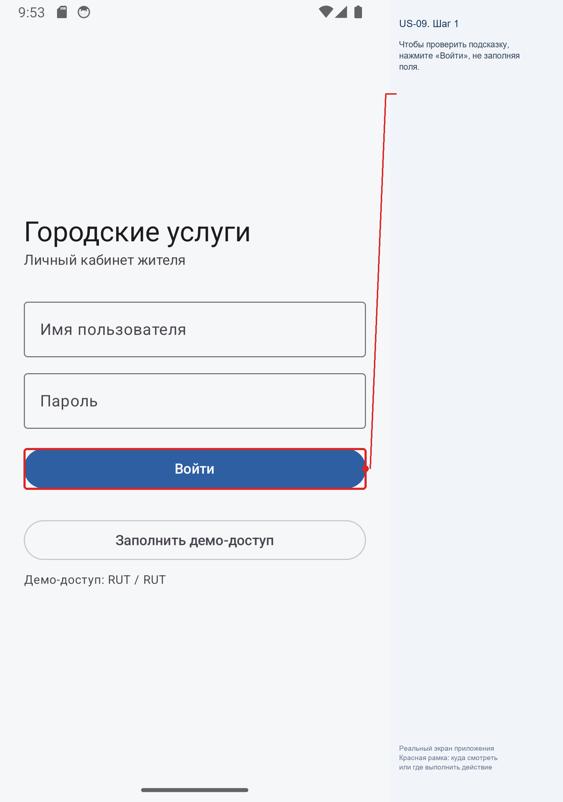

### Шаг 2. Прочитать подсказку

Приложение показывает «Заполните имя пользователя и пароль». Ввести `RUT` в оба поля либо воспользоваться кнопкой демодоступа.

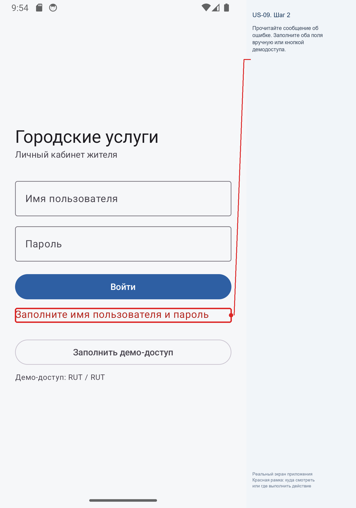

### Шаг 3. Повторить вход

Нажать «Войти» с заполненными полями. Дождаться каталога, как в US-01. Заполнение демодоступа само по себе запрос входа не отправляет.

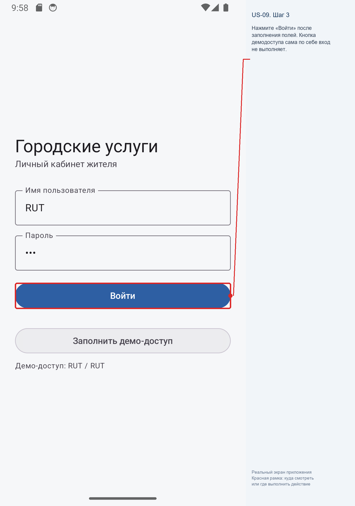

**Критерий выполнения:** пустые данные не позволяют войти, заполненные верные данные открывают каталог. Неверный пароль — другая ошибка, «Неверное имя пользователя или пароль.», установленная по коду, без отдельного снимка в этом комплекте.

## Проверка и воспроизводимость

Каждый из 30 шагов снабжён отдельным изображением с собственными пометками. Состояния успеха и ошибки не смешиваются без пояснения. Выполнены реальные переходы входа, выбора услуги, создания заявки, фильтрации, просмотра уведомлений, выхода и восстановления сессии. Это ручное исследование установленного приложения через ADB, а не полный автоматизированный UI-тест и не результат успешной сборки репозитория.

Исходники для сопоставления: `ui/screen/LoginScreen.kt`, `ServicesScreen.kt`, `ServiceDetailScreen.kt`, `RequestsScreen.kt`, `NotificationsScreen.kt`, `CityServicesApp.kt`, `network/FakeApi.kt`, `core/ServiceLocator.kt`. Путь к Kotlin-пакету: `app/src/main/kotlin/ru/course/cityservices`.

Повторно нанести все пометки на сохранённые оригиналы:

```powershell
python mob_curs_docs/user-stories/annotate.py
```

Требуется Pillow. `capture.py` также позволяет сохранить новый реальный экран командой `python mob_curs_docs/user-stories/capture.py capture NAME`; для этого нужен подключённый Android и ADB в стандартной папке SDK. Координаты пометок рассчитаны на сохранённые оригиналы 1080 × 2220 и должны пересматриваться при изменении разрешения или интерфейса.
